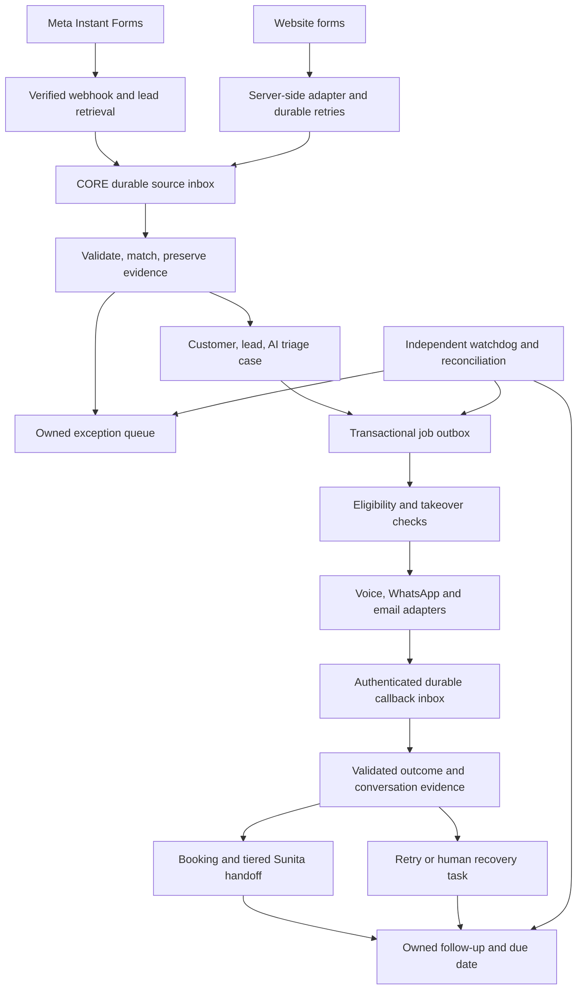

# NYSA CORE — Lead intake, AI calling and follow-up

**Detailed design v1.2 · APPROVED BUILD REFERENCE · 27 October 2026**
**Reference: NYSA-CRM-20261026-LEAD-001**

Full sign-off received 27 October 2026 supersedes the earlier incomplete attachment and inferred defaults. v1.2 is approved for build with the explicit decisions below. No further review round is needed unless an actual conflict appears. Nonvoice development is approved; voice implementation waits for the two-provider UAE/India caller-route gate. Live activation, UAT owner and canary size remain separate approvals after development. Account purchases, funding and real tests require their specific setup authorization.

Pilot: UAE and India only, with confirmed country and timezone (Asia/Dubai or Asia/Kolkata respectively). All other countries and unknown/mismatched country/timezone enter CORE with a human task for Sunita/existing routing and receive no automated calls, WhatsApp or email. Later country expansion is configuration governed by route, hours and consent approval, not a code change. Earlier six-country and proposed-default wording is superseded.
## 1. Outcome and scope

A new Meta Instant Form enquiry enters CORE and an eight-step, three-day call/WhatsApp/email sequence. During calling hours, the first eligible call targets 120 seconds; outside hours, send an immediate permitted WhatsApp acknowledgement and schedule the first call for the next window. The desired outcome is a confirmed callback or meeting with Sunita, with tiered human recovery if booking is not achieved. Website intake follows immediately after canary. No unanswered enquiry is silently closed.

| ID | Confirmed requirement |
|---|---|
| R01 | Meta Instant Forms feed CORE directly; current WhatsApp notifications are not the intake authority. |
| R02 | Website enquiries feed CORE directly. CORE replaces REM; no REM adapter is needed. |
| R03 | Automatic AI voice calls perform initial enquiry verification. |
| R04 | First eligible call target: 120 seconds for in-hours receipt; preserve original submission/transit latency and report out-of-hours separately. |
| R05 | AI handles the multichannel sequence and booking; Sunita is accountable, with Hot/Warm/Cold/Unreached handoffs and existing routing fallback. |
| R06 | CORE remains authoritative for customers, leads, assignments, inventory, qualification and compliance. |
| R07 | Preserve existing users, passwords, teams and configuration. Admin is not an ordinary sales role. |
| R08 | Review design before building; use GitHub and CRM Test before separately approved production activation. |

Canary scope: Meta intake/inbox, deduplication, triage case, call/WhatsApp/email sequence jobs, inbound replies and provider callbacks, booking, tiered handoff/digest, basic business KPIs, kill switch/caps and basic exception list. Website forms follow immediately after canary. Full integration-health UI, backfill tooling, Property Finder and broadcasts follow later. Minimum source/worker health, consent gates, independent watchdog, reconciliation, permissions and rollback remain canary requirements. Use a new 360dialog number; no dependency on REM number migration. REM integration, cancellation, historical import and autonomous eligibility decisions are excluded.

## 2. Baseline and recovery boundary

Design source: origin/main commit `4f1034167c591acb87fe9c025af48835d58630e3`, tree `2416fe6856c2e4417ae1dc4dbae6d0c7ee87aaaf`, isolated lead-intake worktree. Release continuity evidence records production RC1, source `b6e013c51f46be482858e733160fa7e675ff3106`, migration 140; CRM Test DEV239, migration 140. The committed BASELINE.md predates the production release and still describes DEV91. These are prior observations, not a fresh health check.

This task changes documents only. Clean main is the development rollback point; no database mutation or copy is needed. Before future database/configuration work, record actual target version and recoverable file/database snapshot. Earlier release backups do not replace fresh deployment backups. Held invitation fix **NYSA-CRM-20261026-ADM-001** remains separate and awaiting deployment.

## 3. Architecture



**Recommended:** CORE owns durable events, jobs, deadlines and reconciliation. A provider adapter executes narrowly scoped calls. Prefer direct CORE-to-voice integration if hosting supports a reliable supervised worker. Otherwise Make or an authenticated scheduled runner may claim CORE jobs. A separate watchdog must detect runner failure. Validate actual host scheduling before promising a two-minute response.

Make is optional orchestration, not the sole place a lead or retry exists. Select one voice provider after verifying caller identity, destination coverage, language, privacy and costs. Retell/Vapi are candidates, not selected services. The attachment's Claude/Make stack does not require replacing the existing OpenAI advisory implementation. A voice conversational model and CRM advisory model are separate responsibilities.

### Reuse versus new work

| Existing capability | Proposed extension |
|---|---|
| Signed POST /api/intake/website | Connect live forms; retain incomplete enquiries before classification |
| Customer matching and duplicate review | Source namespaces, Meta adapter, safe concurrent matching |
| Routing, assignments, tasks and SLA queues | AI handling and explicit governed handoff |
| Call activity and first-contact rules | Provider lifecycle mapping without false Contacted state |
| Advisory AI and deterministic fallback | Separate bounded voice policy and validated result commands |
| Calendar integration | Pilot booking with availability, customer confirmation and duplicate prevention |
| Communication state model | Live voice adapter, durable dispatch and callbacks |

The Website endpoint accepts Website only. Meta must not be disguised as Website. Current business validation precedes intake event persistence; the new durable inbox must retain legitimate incomplete enquiries before that validation. Existing advisory-only AI rules require an explicitly reviewed exception for this voice workflow.

## 4. Ownership and lifecycle

AI ownership is a processing state, not a fabricated staff account. Each case has an automation handler and an accountable human fallback. Existing assignment rules continue to govern sales ownership. Display “AI handling · fallback Sunita” through an approved queue representation. Never grant Admin sales permissions as a shortcut.

Verify Sunita's active operating identity and routing/team context. Backup uses existing CORE routing to an eligible available agent, not a fixed nominated person. If no eligible available agent can be resolved by existing rules, retain a visible owned escalation; do not copy Test assignments or invent availability. Existing/current leads remain human-owned.

| Triage state | Meaning and next action |
|---|---|
| received | Event persisted; validation/matching pending |
| needs_review | Identity, mapping or permission issue; owned resolution task |
| ready | Lead matched and policy permits dispatch |
| dispatching | One leased worker reserves attempt and rechecks eligibility |
| attempting | Provider accepted a channel attempt; delivery/contact evidence tracked separately |
| engaged | Reply cancels scheduled outreach; AI continues bounded booking conversation |
| booking_pending | Customer selecting/confirming a slot; not booked until calendar confirmation |
| booked | Confirmed callback/meeting recorded; human follow-up remains accountable |
| outcome_unknown | Ambiguous submission or missing events; reconcile before redial |
| retry_scheduled | Approved retry with owner and due time |
| handoff_pending | Sunita task created; acceptance clock running |
| human_owned | Human accepted/took over; initial automation cancelled |
| suppressed | Restriction or policy block with recorded reason |
| complete | Initial triage finished; human follow-up can remain open |

These states do not replace CRM stages. AI verification means the recipient confirms the enquiry and declares requirements. It is not KYC, funding proof, suitability or eligibility approval. Provider acceptance, voicemail, busy and no-answer must not set first_contact_at or Contacted. Meaningful contact requires validated outcome evidence under existing CRM rules.

Every nonterminal case must have a primary next action, owner and due time, or an owned visible exception. A reconciler detects missing actions. Completing triage cannot delete future follow-ups.

Human takeover increments a case generation, invalidates queued jobs and audits the action. Dispatch rechecks generation and restrictions immediately before submission. Already-submitted calls require remote cancellation/reconciliation; show “stop requested” until confirmed. Late callbacks can append history but cannot restore AI ownership or overwrite human decisions.

## 5. Source capture and mapping

### Common envelope

| Field | Rule |
|---|---|
| schema_version | Explicit supported contract version |
| source_system/account/event_id | Source-bound stable identity; unique together |
| source_created_at | Original UTC submission time, unchanged on replay |
| received_at | CORE-generated durable receipt time |
| contact_claims | Name and normalized phone/email with restricted original evidence |
| answers | Original question IDs/labels/values; absent facts remain unknown |
| enquiry_context | Form/page/property reference and business type when known |
| attribution | Available Page/form/ad/campaign/landing metadata |
| permission_evidence | Statement/version, selection, timestamp and permitted purpose |
| payload_digest | Integrity and altered-replay detection |

Same event and digest returns its original receipt. Same ID with changed content creates a conflict. Same customer can have multiple enquiries; reuse customer identity safely without collapsing distinct requirements. If phone matches one person and email another, route to review; never auto-merge.

### Meta Instant Forms

Verify subscription and webhook authenticity through supported Meta procedures. Persist notification before acknowledgement, retrieve the lead through the approved Page connection, preserve original creation time and available leadgen/Page/form/ad/campaign IDs, then apply versioned field mapping. Retry transient retrieval delays. Reconcile source lead IDs against CORE receipts to detect missed notifications.

Confirm current permissions, token lifecycle and test-lead retrieval during setup; do not rely on guessed permission names. An unmapped form becomes needs_mapping and cannot trigger calls using inferred consent.

### Website

Use server-side WordPress form hooks. CRM signing secrets must never reach browser code. Confirm live plugin hooks for Advisor, Brochure, AI Advisory and AI Property Selection forms; existing staging mapping is evidence, not proof of live wiring. Generate a stable submission UUID, original time, form version and durable retry record.

The existing signed boundary uses HMAC over `${timestamp}.${rawBody}`, millisecond timestamps and replay checks. Preserve that contract or explicitly version changes. Website retries retain the same submission ID until CORE acknowledges durable receipt. A failed CRM request must not erase an enquiry or falsely claim delivery.

| Website field | CORE treatment |
|---|---|
| Name, phone, email | Contact claims; no fabricated identity |
| Project/property URL | Source evidence; resolve governed inventory inside CORE |
| Buy/rent/off-plan | Declared requirement; absent remains unknown/Unconfirmed |
| Budget, timeline, purpose | Declared facts with provenance; missing becomes conversation question |
| Brochure request | Specific service request, not blanket channel permission |
| Marketing selection | Explicit true/false and wording; never default true |
| Language/callback preference | Preserve and apply approved supported policy |

Missing classification does not discard intake. Missing permission or unusable contact details blocks voice and creates human review. Final permission wording and calling policy must be approved before activation.

## 6. Multichannel schedule and timing

The requested sequence has eight steps over three days. Before each send, recheck case generation, consent/restrictions, channel availability, local hours, budget and attempt caps. Persist every step as a job; do not run a three-day sleeping workflow. Customer replies/bookings/opt-outs/takeover cancel undispatched scheduled outreach. Unknown remote outcome pauses the sequence until reconciled. Latest clarification: after a WhatsApp/email reply, cancel scheduled outreach and let AI continue the responsive conversation to book. Human takeover or opt-out stops AI. This supersedes the earlier answer to stop all AI.

| Step | Requested timing | Channel | Action |
|---|---|---|---|
| 0 | Immediately on receipt, any hour | WhatsApp template | Acknowledge enquiry and give truthful planned call time; overnight next opening is 10 AM Dubai |
| 1 | Within 120 seconds in calling hours; otherwise next opening | AI call #1 | Confirm enquiry, collect requirements, offer callback/meeting |
| 2 | 15 minutes after missed call #1 | WhatsApp | Missed-call note, reply option and two available slots |
| 3 | 2 hours after call #1 ends, deferred into local messaging hours | Email | Approved brochure/payment information, booking link and reply option |
| 4 | Next day, 10 AM–12 PM Dubai | AI call #2 | Second attempt; aim for different time where feasible |
| 5 | 30 minutes after missed call #2 | WhatsApp | Quick replies: call later / send details / stop |
| 6 | Day 3 at 10 AM lead-local (second calendar day after first call) | Email | Still interested? call / details / not now |
| 7 | Day 3 at 6 PM lead-local | Handoff | End sequence; Unreached digest and optional personal follow-up |

Caps: maximum 2 calls, 3 scheduled customer WhatsApp messages and 2 scheduled emails per sequence. Sunita's internal alert is separate. The 3 WhatsApp/2 email caps apply to the scheduled sequence; approved responsive-chat limit is handoff after 10 AI replies without booking progress; the conversation may remain open up to 24 hours. Slow replies do not trigger a 30-minute timeout. Missing email/WhatsApp or failed delivery creates a channel exception, not a false successful step. Invalid number on all channels stops the sequence; invalid voice alone need not invalidate a working email. No repeated source submission may reset caps for the same sequence.

Requested hours: UAE calls 10 AM–6 PM Dubai; India calls 10 AM–5:30 PM Dubai (11:30 AM–7 PM IST). WhatsApp/email 9 AM–9 PM lead-local, except immediate step 0. Use known IANA timezone and provenance; phone country alone does not prove the lead's location. Unknown or mismatched country/timezone blocks ALL automated contact, including step 0, and creates human review. Pilot timezones are Asia/Dubai and Asia/Kolkata only. Other destination call policies remain unconfigured. Recheck hours at actual dispatch, not only scheduling. If a scheduled step is deferred outside hours, do not compress multiple overdue steps into a burst. Confirmed: Day 3 is the second calendar day after first call; delayed messages defer to 9 AM–9 PM local. Approved Day 3 email is 10 AM lead-local and close is 6 PM lead-local; no compressed catch-up burst.

For leads received during calling hours, measure 120 seconds from durable CORE receipt, and separately preserve source-created latency so upstream delays remain visible. Report dispatch and provider call-started evidence separately; started may not prove ringing. Outside hours, report immediate acknowledgement latency and next-window call due/start independently. At opening, queue by original enquiry age/deadline; concurrency 2 and budget limits may create a backlog, which must be visible rather than claimed as simultaneous 10 AM calls. Do not promise an exact call time in a template if capacity cannot support it.

Engineering target remains a 30-second watchdog interval and pre-breach warning; prove actual scheduler performance. The requested USD 20/day voice ceiling uses a reserved worst-case per-call cost, maximum duration and concurrency 2. Include telephony/model/platform charges in the estimate and reconcile actual charges. Reject a call if sufficient budget cannot be reserved. No fixed calls/day is promised until tariff and maximum duration are known. Approved limits: USD 20/day voice and separate USD 10/day WhatsApp plus email, resetting at Dubai midnight; maximum call duration 8 minutes. Derive calls/day from actual all-in tariff and duration reservations.

## 7. AI conversation and handoff

The agent identifies NYSA and itself as an AI assistant, confirms recipient/enquiry and asks whether it is a suitable time. Final disclosure, recording and permission wording follow approved policy. Refusal is respected immediately. Unsupported language routes to a human.

Suggested question order: enquiry/property confirmation; buy/rent intent; area/project preference; indicative budget; timing; appropriate financing preference; preferred callback slot/language. Do not repeat known answers or force every question. Do not request documents, payment details or unnecessary sensitive data.

The agent cannot promise availability, prices, returns, eligibility or appointments without current governed evidence and an approved command. Form answers and speech are untrusted content, never instructions to bypass tool permissions. AI-generated scores remain advisory and cannot overwrite Hot/Warm/Cold or qualification.

Validated result contract example (synthetic):

```json
{
  "schema_version": "1",
  "case_ref": "triage_demo_001",
  "attempt_ref": "attempt_demo_001",
  "outcome": "callback_requested",
  "declared_requirements": {"purpose": "buy"},
  "missing_fields": ["budget", "area"],
  "next_action": {
    "type": "human_callback",
    "requested_at": "2026-10-27T06:00:00Z"
  },
  "evidence_ref": "evidence_demo_001"
}
```

Allowed outcomes: enquiry_confirmed, callback_requested, no_answer, busy, wrong_person, not_interested, opted_out, language_handoff, technical_failure and uncertain. Validate model results against call lifecycle; model text alone cannot prove connection. Facts retain source/time and uncertainty. Contradictions with human-confirmed facts require review.

Sunita receives a concise summary, declared requirements, missing answers, outcome, next action and restricted evidence link. Do not include transcripts in alerts. English and Hindi launch first; Gujarati/Arabic later. Unsupported language routes to Sunita. Show callback times in Dubai and the lead's confirmed local timezone.

### Tiered handoff and human confirmation

AI suggested tier is distinct from authoritative CRM classification. Store score/rubric version, suggested tier, rationale, acceptance/override and actor/time. Sunita confirms with one click. Suggestions may trigger response urgency without silently approving qualification. Explicit callback/meeting requests signal Hot; contradictory score/timeline signals require review. Section 19 contains the approved advisory rubric.

| Suggested tier | Review trigger | Human work and target |
|---|---|---|
| Hot | Score 9+ or callback/meeting request | Immediate task and WhatsApp alert; accept within 10 minutes, 10 AM–8 PM daily; same-day callback within permitted/customer-agreed hours. Hot clocks start next opening if received outside 10 AM–8 PM Dubai |
| Warm | Score 5–8, engaged but not ready | Summary and task due within 24 hours including weekends; team operates every day |
| Cold | Score 0–4 or exploring/buying 3+ months out | Daily digest; review and recheck task at 30–60 days; no automatic nurture campaign in canary |
| Unreached | No response when sequence expires | Daily digest; optional personal attempt within 48 hours, then human-confirmed Cold nurture eligibility |
| Stopped | Opt-out or wrong person | Restriction recorded; no sales handoff or nurture |

Unaccepted Hot tasks reassign after 30 minutes through existing routing to an eligible available agent. Preserve the original acceptance clock and audit; do not reset lateness through reassignment. If none is eligible, keep an owned exception and escalation. Outside 10 AM–8 PM Dubai, queue urgent work and start the 10/30-minute clocks at the next 10 AM opening. Same-day calling never overrides the approved calling window. Existing team assignments are preserved, while case-specific reassignment uses the explicitly reviewed routing workflow.

### Booking as the desired endpoint

Offer two genuinely free 30-minute slots on Sunita's connected calendar, 10 AM–8 PM Dubai, also displaying lead-local time. Recheck calendar and obtain customer confirmation before booking. Use a short-lived slot hold, idempotent booking key and conflict retry offering fresh slots. The calendar owns confirmed occupancy; a booking link click is not a booking. Store calendar event ID, lead link, start/end/timezone, customer confirmation and status. Reschedule/cancel updates the same booking and next action.

If calendar access fails, do not invent a confirmed meeting. Minimum fallback is a customer-confirmed callback slot persisted in CORE, with assigned human task and visible calendar-sync exception. Refusal/no response remains an explicit outcome; the system cannot guarantee every enquiry books. Payment options/brochures come from approved current CORE content, never generated financial promises.

## 8. Proposed APIs and events

These names are proposed contracts, not implemented endpoints; align final names with repository conventions.

| Contract | Purpose and boundary |
|---|---|
| GET/POST /api/intake/meta | Supported subscription verification and authenticated Meta intake |
| POST /api/intake/website | Existing signature contract, explicitly versioning incomplete-intake changes |
| POST /api/automation/jobs/claim | Scoped worker claims eligible leased jobs |
| POST /api/automation/attempts/{ref}/submission | Report acceptance/unknown outcome for a reserved attempt |
| POST /api/providers/voice/{connection}/events | Authenticated durable provider event receipt |
| POST /api/triage/{ref}/evidence | Structured claims; no arbitrary ownership/stage updates |
| POST /api/triage/{ref}/handoff | Governed assignment and task transaction |
| POST /api/triage/{ref}/takeover | Authorized human cancels initial automation |
| POST /api/triage/{ref}/restriction | Prompt opt-out capture with evidence |
| POST /api/providers/whatsapp/{connection}/events | Verified inbound replies, delivery and opt-out evidence |
| POST /api/providers/email/{connection}/events | Verified reply/delivery/bounce/complaint receipt |
| POST /api/triage/{ref}/tier-decision | Authorized human accepts/overrides advisory tier |
| POST /api/triage/{ref}/bookings | Confirm customer choice through governed calendar flow |

No unrestricted PATCH-any-lead or public lookup-by-phone API. Bind commands to connection, case, job, generation and permitted operation. A callback cannot select a different lead. Workers receive only the minimum contact/context for the leased attempt.

Events contain event_id, schema_version, occurrence/receipt times, aggregate reference, generation and correlation ID. Types include intake.accepted, triage.ready, attempt.submitted/started/ended/analyzed, restriction.recorded, handoff.requested/accepted and followup.due.

Acknowledge only after durable receipt; process asynchronously. Valid duplicates receive the original safe acknowledgement. Persistence failures return retryable errors. Permanent business/mapping errors become durable review items rather than endless transport retries. Authentication failures disclose no customer data. Apply provider-supported raw-body verification, replay protection and binding; do not assume every provider uses website HMAC. Credentials are scoped, rotating and server-side.

## 9. Logical data model and consistency

Final migration numbers follow the actual migration head at implementation. This document executes no SQL.

| Logical record | Key content/constraint |
|---|---|
| integration_connections | Account/source binding, enable state, secret reference, mapping/policy version, health |
| source_event_inbox | Unique source/account/event ID, digest, original/receipt times, restricted payload reference, processing state |
| ai_triage_cases | Lead reference, generation, state, human fallback, policy version, deadline and next action |
| automation_jobs/outbox | Unique case/purpose/generation key, due time, lease expiry, retry count and terminal reason |
| voice_attempts | Unique reserved attempt key, provider call ID, lifecycle times and reconciliation status |
| provider_event_inbox | Unique provider/connection/event identity or documented stable digest, safe processing status |
| handoff_receipts | Case/assignee, request/accept times, SLA and escalation reason |
| conversation_evidence | Restricted claims/summary/transcript/recording references, retention deadline and access audit |

Existing customers, leads, tasks, activities, assignments and restrictions remain authoritative. Avoid a parallel lead database. Reuse existing tables where semantics fit rather than forcing Meta into Website-only records.

Transactions create/link lead, case, deadline and outbox together. Outcome application creates one activity and its next action/handoff together. Unique keys prevent duplicate work. Use transactional leases and compare-and-set generations, not process-local flags. Index due jobs, open cases, provider IDs and reconciliation keys; test migration locking/duration on the rehearsal baseline.

External submission cannot be atomic with a database commit. Reserve attempt first; use provider idempotency where documented. Timeout enters outcome_unknown and reconciliation. If safe provider correlation is unavailable, require human resolution rather than blind retry. Ended and analyzed may arrive out of order; apply monotonic facts and append analysis without duplicate activity/handoff.

## 10. Screens and operational workflow

### Lead response board

Operational columns: New/ready, AI attempting, Retry due, Sunita handoff, Human follow-up and Needs attention. Rows show source, lead reference, source age, deadline, actual provider state, next action and owner. Counts open the exact corresponding records. Show source transit delay separately from CORE processing delay.

### Lead detail

Timeline shows intake/attribution, declared requirements, call lifecycle, AI summary, human acceptance, tasks and restrictions. Controls: Take over, accept handoff, schedule/complete follow-up, correct declared facts through governed flows and stop contact. Restricted evidence requires explicit permission; recordings are disabled.

### Integration health

Admin configuration view: last event, source lag, reconciliation gaps, authentication expiry, worker heartbeat, queue age, callback lag, cost caps and kill switch. Sales actions remain under operating permissions. Default health details use aggregate/opaque references.

### Exception queue

Identity conflict, unmapped form, invalid number, missing permission, inactive fallback, overdue handoff, outage, unknown call outcome and missing next action. Every item has owner, deadline, safe resolution controls and audit. Replay keeps original identity/clocks and cannot erase a breach.

## 11. Permissions, privacy and controls

| Actor | Boundary |
|---|---|
| Admin | Connector/policy configuration and safe health; no implied sales privileges |
| Sunita/approved agent | Existing authorized lead scope, handoff acceptance, tasks and permitted evidence |
| Manager | Existing team/routing/escalation authority |
| Intake adapter | Source-bound submission; no arbitrary customer read |
| Voice worker | Eligible job claim and attempt/evidence commands; no broad CRM editing |
| AI model | Minimal context and allowlisted tools; no database credentials or assignment authority |

Audit configuration, replay, dispatch, restrictions, takeover, handoff and evidence access. Service credentials are split by source/channel. General logs contain opaque references and safe codes, excluding phone/email, tokens, transcripts and recording URLs. Minimize provider/Make execution history too. Encrypt transport/restricted storage and use authorized expiring evidence access.

Review-selected policy: new versioned consent explicitly covering AI calls, WhatsApp and email; requested Meta phone verification; AI disclosure at call start; recordings OFF. Restricted call transcripts and structured summaries retained 12 months. Store retention start/expiry and audit deletion, including processor copies/backups under a documented policy. Phone verification proves control, not KYC or blanket permission. Confirm actual Meta verification availability/evidence and processor recording/transcription settings before activation; do not claim verification from absent data. Final wording and processor arrangements remain live-readiness gates.

Global/source/provider kill switches stop new dispatch and request remote cancellation while intake and human recovery continue. Approved daily spend, concurrency and attempt caps are enforced before dispatch. Cap exhaustion creates human work, not dropped leads.

## 12. Failure recovery and operations

| Failure | Required recovery |
|---|---|
| CORE outage | Website durable retries; source/provider retry and reconciliation; no false receipt |
| Missing classification | Retain event and owned review; no invented answers |
| Duplicate/concurrent receipt | One event result and initial job |
| Meta access expires | Alert, retain pending work and controlled backfill after repair |
| Worker/Make unavailable | Independent heartbeat/watchdog and human fallback |
| Provider timeout | Unknown outcome; reconcile before redial |
| Lost callback | Supported status query or owned timeout exception |
| Callback order/duplication | Monotonic reducer, one activity/handoff |
| Unsafe/invalid AI result | Reject commands; preserve safe evidence and create human task |
| Sunita unavailable | Use existing routing to eligible available agent; unresolved routing is an exception |
| Takeover/opt-out race | Generation check, remote stop and reconciliation |
| Alert failure | Dashboard exception persists; alternate approved route |
| Budget cap reached | Preserve lead/deadline; human recovery |

Daily operating review covers source totals versus CORE receipts, unresolved exceptions, unaccepted handoffs, overdue tasks, authentication expiry and spend. Historical backfill never automatically triggers calls: require a bounded range, deduplication preview and approved contact eligibility.

## 13. Accounts and setup responsibilities

| Item | Required evidence before pilot |
|---|---|
| Meta | NYSA-owned access/app connection, current permissions, token lifecycle, versioned form mapping and synthetic lead round trip |
| Website, after canary | Approved staging access, live hooks, signing secret and retry proof |
| Voice provider | NYSA-owned account, approved caller route/coverage, billing cap, versioned agent and lifecycle test |
| Make, if retained | Protected connections, history policy, error recovery and independent watchdog |
| CORE | Reliable worker schedule, scoped service identity, secret storage, Sunita identity and existing-rule fallback |
| Test calling | Explicitly approved team numbers and script; no arbitrary real leads |
| Calendar | Required for pilot booking: authorized calendar, free/busy, dual timezones and duplicate prevention |

Account status must be confirmed at setup; earlier account absence is historical. Business will publish the new consent/phone-verification form, open a new 360dialog pilot number and approve templates. lead@nysarealty.com requires authenticated outbound and inbound reply integration. Validate caller route before purchase/build. Credentials stay in protected setup flows. REM number migration remains separate.

## 14. Verification and acceptance

| ID | Scenario | Pass condition |
|---|---|---|
| T01 | Meta synthetic lead | One lead/case/job, correct source and original deadline |
| T02 | Each live website form | Correct mapping, unknowns preserved, no consent defaults |
| T03 | Duplicate/altered replay | Idempotency or visible conflict; no second call |
| T04 | Concurrent deliveries | No duplicate customer/job for same event |
| T05 | Same person/new enquiry | Correct customer reuse and distinct enquiry policy |
| T06 | Conflicting phone/email | Owned review, no merge/call |
| T07 | Incomplete payload | Durable evidence and visible resolution task |
| T08 | Complete call | Verified lifecycle, validated summary, handoff and acceptance |
| T09 | Busy/no-answer/voicemail | No false Contacted; owned next action |
| T10 | Timeout after acceptance | Reconciliation without blind redial |
| T11 | Duplicate/out-of-order callback | One activity/handoff; no state regression |
| T12 | Takeover/opt-out race | Jobs invalidated; remote stop reconciled |
| T13 | Provider/AI/Make outage | Intake retained, watchdog and fallback work |
| T14 | Restart/expired lease | Durable recovery and single active attempt |
| T15 | Inactive Sunita/no eligible routed agent | Visible blocking exception |
| T16 | Bad signature/wrong binding/replay | Denied without leakage or unauthorized mutation |
| T17 | Role/service permissions | Allowed and denied actions match role matrix |
| T18 | Prompt injection/unsafe output | No unauthorized tool, ownership or qualification change |
| T19 | Privacy/retention | Restricted evidence access; no customer content/secrets in general logs |
| T20 | Missing source notification | Reconciliation safely recovers |
| T21 | Overdue/missing follow-up | Owned exception and tested alert |
| T22 | Timing under approved pilot load | Source/CORE/provider evidence supports reported metric |
| T23 | Budget/kill switch | New dispatch stops; human recovery preserved |
| T24 | Migration/rollback rehearsal | Paired recovery and existing configuration/assignments retained |
| T25 | Regression | Routing, classification, activities, reports and calendar continue working |

Use synthetic fixtures locally, then approved team-number/provider tests, then CRM Test UAT. Define pilot load/concurrency before timing tests. Report sample size, percentile and breaches; one successful call cannot prove the target.

Business walkthrough: submit Meta and website test enquiries, observe receipt/countdown, receive approved test call, provide requirements/callback request, and verify Sunita's summary/task/acceptance. Repeat no-answer, opt-out, source/provider outage, takeover and overdue follow-up. Sign-off requires an understandable operational workflow as well as technical checks.

## 15. GitHub delivery, activation and rollback

1. Review this design and decisions; finalize source mappings and bounded automation policy.
2. Complete the separately approved two-provider International caller-route gate before voice implementation. Nonvoice build order follows design sign-off.
3. Implement isolated multichannel code/migrations and synthetic tests with dispatch disabled; establish protected accounts and approved team-number tests.
4. Push changes through GitHub PR, CI and review. Keep held Admin invitation fix separate.
5. Build only with `npm run release:package -- --commit <full-40-character-origin-SHA>` using a commit advertised by origin. Never package the working directory.
6. Run `npm run release:verify-package -- <zip> <manifest> <manifest-sha256-file>`; install verified candidate in CRM Test and record UAT.
7. Obtain exact candidate/migration/activation/window production approval. Refresh paired file/database backups and verify private encrypted off-server recovery immediately before deployment.
8. Deploy with dispatch off; verify migrations, existing users/assignments/configuration and source health. Activate only the approved bounded canary, then review acceptance before expansion.

Prove direct delivery before disabling an existing source path. Use stable source IDs to reconcile overlap. REM cancellation and historical migration are not incidental cutover actions.

Rollback disables dispatch first and requests remote cancellation. Preserve a private external-dispatch reconciliation ledger before restoring the complete paired backup: database restore cannot undo calls already made and must not cause restored jobs to redial them. Test that reconciliation procedure before production. Return the application to the state specified by the exact feature-release rollback approval; do not assume an earlier release's stopped-state instruction applies to every future deployment.

## 16. Revised D01–D12 decision register

| ID | Business review incorporated | Remaining detail |
|---|---|---|
| D01 | Meta first with voice/WhatsApp/email; website immediately after canary; Property Finder/broadcasts later | None on scope |
| D02 | CORE durable authority; direct adapters when reliable; optional Make runner | Validate hosting schedule |
| D03 | Sunita accountable; existing routing selects available backup | Verify operating identity and availability signal |
| D04 | Eight-step three-day sequence; max 2 calls/3 WhatsApp/2 email; stated hours | Approved: 24-hour conversation; 10 replies without progress; Day 3 10 AM/6 PM local |
| D05 | Tiered handoff; Hot 10-minute acceptance, 30-minute reroute; digest | Approved rubric; out-of-hours Hot clocks begin next opening |
| D06 | New channel-specific consent/version and phone verification; AI disclosure; recording off; restricted transcript/summary 12 months | Verify form/provider evidence; approve final text/processors |
| D07 | Two-provider international route gate before voice build; USD 20/day voice; concurrency 2 | Approved test numbers/accounts; voice USD 20/day, 8-minute limit; messages USD 10/day |
| D08 | English/Hindi; unsupported language to Sunita; Dubai/local callback display | Approve final scripts and timezone capture |
| D09 | New enquiries only; existing/current leads human-owned | Older-form new enquiries default human-only until explicit permission policy |
| D10 | Live website hooks after canary, not Meta blocker | Later mapping/UAT |
| D11 | In-hours receipt target; dispatch and provider-start evidence; outside-hours separate | Preserve source delay; approve load and backlog reporting |
| D12 | Route-test numbers before voice build; UAT owner/canary size later | Route-test numbers confirmed required before voice build; UAT/canary size later |

Build approved by the 27 October sign-off and chat clarification. Use the concrete defaults documented in this reference; unspecified live inputs remain activation gates.

## 17. Traceability and technical references

R01/R02: sections 5/8, T01–T07/T20. R03/R04: sections 6–9, T08–T14/T22. R05: sections 4/10, T15/T21. R06/R07: sections 7/11/15, T17/T18/T24/T25. R08: sections 14–16.

Repository evidence: src/routes/website-intake.js; src/routes/lead-operations.js; src/routes/crm.js; src/routes/ai.js; src/ai-service.js; src/communication-domain.js; src/communication-connector.js; src/routes/integrations.js; docs/RELEASE_3A_TRUSTED_INTAKE_AND_LEAKAGE_CONTROL_DESIGN.md; docs/RELEASE_3A_WEBSITE_TO_CRM_TEST_FIELD_MAPPING.md.

Input: user-supplied NYSA_CORE_Integration.md. Embedded migration/cancellation instructions are design material, not execution authority.

Primary references checked during preparation, 26 October 2026:

- [Meta-owned lead retrieval checker](https://github.com/facebookincubator/catalogue-of-api-solutions/blob/main/solutions/leads/leads-retrieval-set-up-checker.md): subscription, lead IDs and retrieval diagnostics; confirm current product permissions during setup.
- [Retell call API](https://docs.retellai.com/api-references/create-phone-call) and [webhook lifecycle](https://docs.retellai.com/features/webhook-overview): submission, ended and analyzed are distinct evidence. Retell remains a candidate.
- [Make webhooks](https://help.make.com/webhooks): queue and processing behavior informs CORE-owned recovery.
- [360dialog webhooks](https://docs.360dialog.com/docs/messaging/webhook): pilot WhatsApp channel; message delivery does not prove two-way contact.

**Preparation status:** design documents only. No runtime implementation, migrations, accounts, outbound calls or production changes performed for this document. Tests and release evidence will accompany the implemented candidate after review.


## 18. Full sign-off decisions Q4–Q7

Source: Sign-off NYSA-CRM-20261026-LEAD-001 v1.1 (full).docx, dated 27 October 2026. Full attachment contains explicit decisions, corrections and setup tasks; no tracked edits or comment text. It supersedes the incomplete sign-off and prior inferred limits.

- **Q4 approved:** Day 3 email 10 AM lead-local; close sequence 6 PM lead-local; Warm follow-up within 24 hours including weekends. Hot outside 10 AM–8 PM Dubai starts its 10/30-minute clocks at next 10 AM. Same-day contact never overrides approved windows.
- **Q5 approved:** voice USD 20/day, Dubai-midnight reset, maximum duration 8 minutes, concurrency 2. Separate WhatsApp/email combined cap USD 10/day. Chat may remain open up to 24 hours; after 10 AI replies without booking progress, hand off. Remove the 30-minute limit. An open conversation does not override messaging permissions/windows.
- **Q6 approved:** UAE/India automation only. Every other country or unknown country/timezone is captured with human recovery and no automated contact. Test only Asia/Dubai and Asia/Kolkata plus the other-country human path; DST is not a pilot requirement.
- **Q7 approved:** explicit callback/meeting requests are urgent. Other score/timeline contradictions go to Sunita with evidence, without setting authoritative tier.

Latest chat clarification remains: a reply cancels scheduled outreach while AI continues booking conversation within the approved limits. Missing live credentials, templates, calendar/identity setup, UAT owner, canary size and exact activation remain operational gates, not reasons to reopen design approval.
## 19. Proposed advisory scoring rubric

**Approved for pilot, advisory only.** Four dimensions, each 0–3, total 0–12. Evaluate only customer-declared facts; preserve evidence and rubric version. No score for nationality, wealth assumptions, protected traits or inferred creditworthiness. Missing answers are unknown, not zero: show partial score and completion, withhold an automatic tier until sufficient evidence or human review. No claim of KYC or verified funds.

| Dimension | 0 | 1 | 2 | 3 |
|---|---|---|---|---|
| Purchase/rental timing | Explicitly exploring/no plan | Beyond 3 months | 1–3 months | Within 30 days |
| Requirement clarity | Explicitly has no defined need | General interest | Purpose/area or property type stated | Clear purpose and area/property need |
| Budget clarity | Explicitly undecided | Broad indication | Indicative budget/range stated | Range plus payment preference stated |
| Next-action readiness | Explicitly declines next step | Wants information only | Agrees to later follow-up | Requests callback/meeting |

Suggested thresholds follow the review: 9–12 Hot, 5–8 Warm, 0–4 Cold; no response becomes Unreached, not score zero. Explicit booking/callback request triggers urgent handling even with incomplete score. Suggested tier, accepted tier and CRM qualification remain separate. The review's “3+ months → Cold” may conflict with a high total; surface that conflict for Sunita under approved Q7. Map Meta timeline “Immediately” to “Within 30 days.” Display declared budget beside score without scoring budget size. Record rubric version, per-dimension points, evidence source/time and accept/override with reason. Review accepted versus overridden tiers after canary. Never overwrite human classification with later AI scoring.

## 20. Channel, booking and digest additions

### Logical data additions

| Record | Required additions |
|---|---|
| sequence_instances | Policy version, start/expiry, generation, channel eligibility, current state and stop reason |
| sequence_steps | Unique sequence/generation/step, requested and adjusted due time, timezone provenance, skip reason, job reference |
| channel_events | Provider/account/event identity, direction, channel, receipt/delivery/reply/bounce/complaint/opt-out, opaque correlation and restricted evidence |
| channel_attempts | Reserved submission key, provider message/call ID, unknown state, cost reservation and actual cost |
| consent_evidence | Form/statement version, scope per channel, verification evidence, timestamp and restriction history |
| tier_suggestions | Score dimensions, unknowns, rubric/model version, suggested tier, rationale, human confirmation/override |
| bookings | Lead/customer confirmation, slot hold, calendar ID, idempotency key, timezone, status and sync exception |
| digest_items | Unique lead/tier/action window, Sunita scope, due/review state; derived from authoritative tasks |
| budget_reservations | Daily ledger, currency, max-cost estimate, active reservation, actual cost and release reason |

Phone verification must be evidenced by supported Meta configuration/payload or an approved separate method. Do not invent a verified flag when the form only contains a phone number. New enquiries on older forms default to human-only review until approved permission evidence exists; existing/current leads remain human-owned.

### WhatsApp

Use the new 360dialog pilot number. Step 0 and later outbound messages require approved templates when no active customer-service window exists. A Meta Instant Form submission does not itself open that WhatsApp window. Determine template/free-form eligibility at send time. Step 2/5 must also have template variants because a missed call is not a WhatsApp reply. Sent/delivered/read/replied remain distinct. Process inbound reply/STOP durably and immediately invalidate remaining sequence jobs. Interpret clear natural-language opt-outs too; ambiguity routes to a human and pauses outreach. Template approval, locale and quality failures create recoverable exceptions.

### Email

Use lead@nysarealty.com with protected authenticated sending and inbound reply processing. Verify sender-domain authentication and reply mailbox before canary. Correlate replies using message identifiers plus opaque tokens; email text and headers are untrusted. Authenticate inbound provider events; unmatched replies enter review rather than being attached by guessed identity. Handle bounces, complaints and unsubscribe independently; opens/clicks are not proof of contact. One-click action links use expiring opaque tokens and a confirmation page; link-scanner GET requests must not book, opt out or mark interest automatically. No sensitive CRM IDs or contact data in URLs.

Opt-out stops the entire initial sequence as requested; preserve channel/global restriction scope explicitly. Wrong person prevents continued outreach to that identity. Booking or human takeover cancels scheduled outreach; booking reminders require a separate approved policy and must not silently add sequence sends.

### Booking and digest

Calendar confirmation and CORE booking write use a recoverable saga: reserve slot, recheck availability, create idempotent event, persist confirmation and reconcile ambiguous outcomes. Never announce success before confirmation. A customer-confirmed callback stored in CORE is the fallback if external calendar sync is unavailable, with a visible human task.

Cold/Unreached daily digest is a scoped view of actionable records, with acknowledge/next-action controls. Nurture membership is not authorization for broadcast sends. Hot rerouting follows current team eligibility and availability; missing manager/availability setup is an exception rather than a reason to alter production teams.

### Business KPIs

Use intake cohorts and unique leads, excluding synthetic tests. Contact rate = leads with validated two-way interaction / eligible cohort. Enquiry-confirmed rate = explicitly confirmed enquiries / cohort, also show rate among contacted. Bookings per 10 = 10 × unique leads with confirmed callback/meeting / cohort, split callback vs meeting and exclude cancelled bookings. Show submission-to-booking and handoff-to-acceptance times, with unaccepted counts. Cost per meeting = attributable channel/AI/telephony cost / confirmed meetings, currency and period explicit; if zero meetings show unavailable plus total spend. Opt-out rate = unique opted-out leads / contacted cohort, with delivered-recipient denominator also shown for channel comparisons. Display sample size, time range, unknown costs and immature three-day cohorts; never count API acceptance as contact.

## 21. International caller-route gate before voice build

**Status: plan only; no tests run, no results fabricated.** Two candidate platforms: Retell and Vapi, each with a lawful supported telephony route. These are agent platforms, not guarantees of caller-number availability or country coverage. Verify account/provider/carrier support before attempting calls. Do not spoof caller ID or assume a local Indian/UAE number can be purchased/imported. If a destination route fails, propose an approved alternative carrier/local route or WhatsApp/email-first with human calling; changing the sequence requires sign-off.

Initial pilot route-test destinations: UAE and India only. Select 5–10 consenting team numbers per initial priority destination where practical, across available networks/devices; if fewer are available disclose the coverage gap. Repeat the same controlled scenario with both providers, varying order to reduce comparison bias. Use English/Hindi where relevant; unsupported languages test human fallback. Country code and actual participant location/timezone are recorded separately. No customer numbers or public test numbers.

| Test | Proposed pass criterion, requiring sign-off |
|---|---|
| Route/connect | At least 90% of prearranged available participants connect; report raw numerator/denominator |
| Caller identity | All recipients see the approved actual route identity; no unexpected/spoofed identity |
| Spam label | No observed spam/scam label on tested devices; any label blocks that route pending resolution |
| Speech | English/Hindi testers rate intelligibility at least 4/5; no critical wrong requirement/callback date |
| Conversation | Disclosure/refusal/unsupported-language handling works in every scripted safety case |
| Privacy | Recording off verified; transcript access restricted and retention settings evidenced |
| Lifecycle | Submission/start/end/result correlate; timeout handling creates no duplicate call |
| Cost/caps | Measured tariff supports duration-based reservations, USD 20/day and concurrency 2 |

Team answer rate is a technical route check, not predicted customer conversion. Small samples cannot prove spam-free delivery on every network. Observe live timing while recording is off; retain restricted tester feedback and opaque call references. Pilot scheduling tests cover Asia/Dubai and Asia/Kolkata only, plus human recovery for every other/unknown location. DST tests are deferred; destination connectivity needs approved actual calls.

Results register for each platform × destination: route/caller identity, approved sample IDs, network coverage, attempts/connected, label observations, language ratings, call timing, cost, privacy evidence, defects and go/no-go. All cells currently NOT RUN. Gate passes only for evidenced routes and approved countries; unresolved destinations stay human recovery. Meta capture remains country-neutral. Existing routing, required permissions and local-hour configuration must also pass before automatic contact.

## 22. Additional acceptance tests and phased schedule

Retain T01–T25; T02/live website UAT is after canary. Extend T08 to callback/meeting confirmation, T12 to all channels, T15 to dynamic routing, T19 to 12-month evidence and recording off, T22 to in-hours/out-of-hours cohorts and opening backlog.

| ID | Added scenario | Required outcome |
|---|---|---|
| T26 | Eight steps, Asia/Dubai and Asia/Kolkata, overnight arrival | Correct windows, no compressed catch-up burst, caps respected |
| T27 | WhatsApp/email response racing queued call | Remaining sequence cancelled; AI conversation bounded; human takeover still stops it |
| T28 | Templates/window expiry and provider rejection | Valid send type or owned exception; no bypass |
| T29 | Bounce/complaint/STOP/unsubscribe/wrong person | Correct restriction, no later sequence sends |
| T30 | Calendar race, timeout and duplicate booking | One confirmed slot/event or truthful fallback; no double booking |
| T31 | Suggested tier and conflicting facts | Advisory only, one-click confirm/override and audit |
| T32 | Hot unaccepted 10/30-minute clocks | Visible breach and existing-rule reroute; no eligible agent is explicit exception |
| T33 | Cold/Unreached digest | Correct unique rows, owners and next actions, no accidental nurture sends |
| T34 | Concurrent cost reservations/midnight rollover | No submission beyond reserved limit; unknown actual costs remain visible |
| T35 | Old consent form/unverified phone | Human-only review without inferred permission |
| T36 | Other/unknown country, unknown/mismatched timezone or route disabled | Lead retained with human task; no automated call, WhatsApp or email |
| T37 | Email scanner opens action link | No booking/opt-out/interest mutation on GET |
| T38 | Cross-channel duplicate and out-of-order reply | One coherent case, no reactivated sequence |

### Estimated effort and dates

Planning estimate for one implementation stream, not a fixed-price or delivery commitment. Provider approvals and business responses are elapsed dependencies, not engineering days. No implementation is started by this revision.

| Work package | Estimated working days |
|---|---|
| Resolve design, mappings and test setup | 1–2 |
| Two-provider UAE/India route gate and report | 1–2 after accounts/routes/team numbers ready |
| Durable Meta intake, consent, deduplication and scheduling | 3–4 |
| WhatsApp/email inbound/outbound, restrictions and recovery | 4–6 |
| Voice adapter after gate, booking, tiers and digest | 4–6 |
| Integrated failure tests, regression, CRM Test and GitHub package evidence | 4–5 |
| Total sequential planning range | 17–25 working days plus external waits |

Illustrative dates only: if sign-off and all prerequisites were ready 28 October 2026, a Monday–Friday engineering calendar with no holidays puts canary readiness around 19 November–1 December 2026. This reduced two-country estimate saves approximately one engineering day; external account/template delays still shift the range. UAT owner, canary size and live activation remain deferred decisions; readiness is not approval to deploy. Website integration follows canary acceptance, estimated an additional 3–5 working days after live hooks/access are available. Full health UI, backfill tooling, Property Finder and broadcasts are separate follow-on estimates.

## 23. Revision evidence and limits

27 October revision is documentation only. No migrations, runtime changes, accounts, test calls, customer messages or production operations. Original v1.0 and source response preserved. This v1.1 includes unresolved proposals clearly marked for review. Build is approved; voice work additionally waits for the UAE/India route gate.

Current primary references for channel constraints: [360dialog templates](https://docs.360dialog.com/docs/resources/templates) describes approved templates outside an active customer conversation; [Vapi phone calling](https://docs.vapi.ai/phone-calling) distinguishes imported outbound numbers from free inbound numbers. These references do not establish approval or availability for a particular destination. Validate selected account/carrier route during the gate.


### Pilot country coverage confirmed by full sign-off

Two providers, UAE and India only. All other destinations are deferred. No DST requirement for pilot scheduling. Store confirmed location/timezone independently from phone prefix. Outside/unknown pilot location produces a human task and no automated contact. Future expansion requires approved configuration and route/consent/hours tests.
## 24. Final full sign-off record

Source: Sign-off NYSA-CRM-20261026-LEAD-001 v1.1 (full).docx, 27 October 2026. Earlier truncated attachment and default assumptions superseded. Build against this v1.2; no further design review unless a concrete conflict appears. Nonvoice build underway; voice gate NOT RUN. Live activation, UAT owner and canary size remain separate approvals.

NYSA setup: new Meta consent/verification form; new 360dialog number and step 0/2/5 templates; authenticated lead@nysarealty.com sending/replies; Sunita free/busy/booking connection; private UAE/India team numbers; both candidate voice accounts. Development: implement nonvoice workflow, maintain evidence, run separately authorized route tests before voice implementation.

This incorporation updates design and policy tests only. No migration applied, live calls/messages or production changes. Prior v1.2 retained as PRIOR-SIGNOFF-HISTORY; v1.0/v1.1 preserved.

## 25. Interface requirement confirmed during build

The business explicitly requested a user interface on 27 October 2026. Deliver Administration setup/status alongside backend integration controls, plus role-scoped agent board, booking/handoff and digest. Credentials use protected provider connection flows; no secrets in ordinary setup forms. Admin configuration does not grant operational lead privileges. Initial local setup draft UI is implemented; real connect/test controls are pending provider adapters and must not claim readiness prematurely. CRM Test and production remain unchanged during local development.
