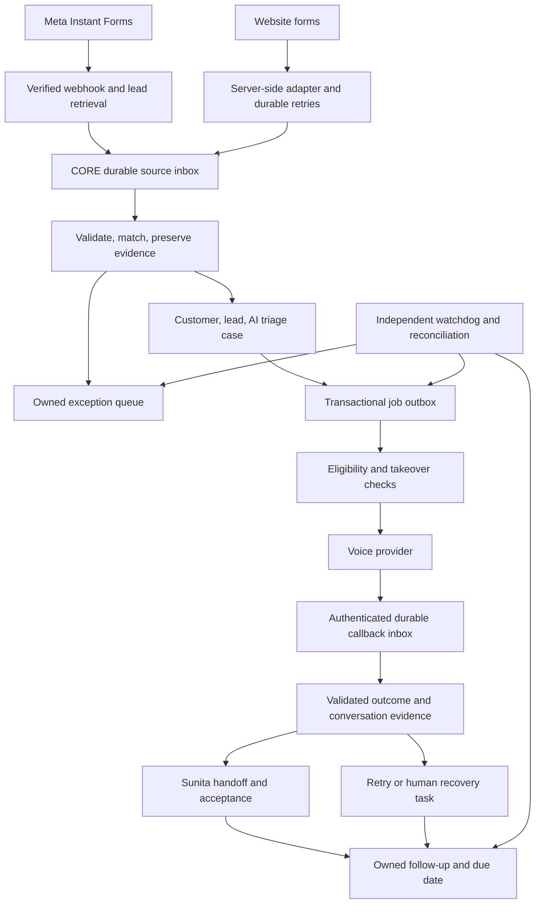

# NYSA CORE — Lead intake, AI calling and follow-up

**Detailed design v1.0 · FOR REVIEW · 26 October 2026**
**Reference: NYSA-CRM-20261026-LEAD-001**

This is a proposed specification for business and technical review before implementation. Confirmed requirements and proposed defaults are distinguished below. Document approval does not authorize paid accounts, real calls, production changes or changes to existing staff assignments.

## 1. Outcome and scope

A person submits a Meta Instant Form or an enquiry on nysarealty.com. CORE retains the enquiry, starts an eligible AI voice contact attempt within two minutes, records its outcome, and gives Sunita Sinha an actionable handoff. Unanswered calls, errors and overdue follow-ups stay visible and owned until resolved.

| ID | Confirmed requirement |
|---|---|
| R01 | Meta Instant Forms feed CORE directly; current WhatsApp notifications are not the intake authority. |
| R02 | Website enquiries feed CORE directly. CORE replaces REM; no REM adapter is needed. |
| R03 | Automatic AI voice calls perform initial enquiry verification. |
| R04 | First eligible attempt target: 120 seconds from original submission. |
| R05 | AI handles initial enquiries, then hands to Sunita; she is also unsuccessful-contact fallback. |
| R06 | CORE remains authoritative for customers, leads, assignments, inventory, qualification and compliance. |
| R07 | Preserve existing users, passwords, teams and configuration. Admin is not an ordinary sales role. |
| R08 | Review design before building; use GitHub and CRM Test before separately approved production activation. |

Pilot scope: capture, deduplication, AI handling, call outcomes, Sunita handoff, tasks, reminders, dashboards and recovery. Later work: direct Property Finder adapter, automated WhatsApp and broadcasts. Excluded: REM integration, historical import, REM cancellation, WhatsApp number migration and autonomous property eligibility decisions. 360dialog is not required for the voice pilot.

## 2. Baseline and recovery boundary

Design source: origin/main commit `4f1034167c591acb87fe9c025af48835d58630e3`, tree `2416fe6856c2e4417ae1dc4dbae6d0c7ee87aaaf`, isolated lead-intake worktree. Release continuity evidence records production RC1, source `b6e013c51f46be482858e733160fa7e675ff3106`, migration 140; CRM Test DEV239, migration 140. The committed BASELINE.md predates the production release and still describes DEV91. These are prior observations, not a fresh health check.

This task changes documents only. Clean main is the development rollback point; no database mutation or copy is needed. Before future database/configuration work, record actual target version and recoverable file/database snapshot. Earlier release backups do not replace fresh deployment backups. Held invitation fix **NYSA-CRM-20261026-ADM-001** remains separate and awaiting deployment.

## 3. Architecture



**Recommended:** CORE owns durable events, jobs, deadlines and reconciliation. A provider adapter executes narrowly scoped calls. Prefer direct CORE-to-voice integration if hosting supports a reliable supervised worker. Otherwise Make or an authenticated scheduled runner may claim CORE jobs. A separate watchdog must detect runner failure. Validate actual host scheduling before promising a two-minute response.

Make is optional orchestration, not the sole place a lead or retry exists. Select one voice provider after verifying caller identity, destination coverage, language, privacy and costs. Retell/Vapi are candidates, not selected services. The attachment's Claude/Make stack does not require replacing the existing OpenAI advisory implementation. A voice conversational model and CRM advisory model are separate responsibilities.

### Reuse versus new work

| Existing capability | Proposed extension |
|---|---|
| Signed POST /api/intake/website | Connect live forms; retain incomplete enquiries before classification |
| Customer matching and duplicate review | Source namespaces, Meta adapter, safe concurrent matching |
| Routing, assignments, tasks and SLA queues | AI handling and explicit governed handoff |
| Call activity and first-contact rules | Provider lifecycle mapping without false Contacted state |
| Advisory AI and deterministic fallback | Separate bounded voice policy and validated result commands |
| Calendar integration | Optional governed meeting request with availability checks |
| Communication state model | Live voice adapter, durable dispatch and callbacks |

The Website endpoint accepts Website only. Meta must not be disguised as Website. Current business validation precedes intake event persistence; the new durable inbox must retain legitimate incomplete enquiries before that validation. Existing advisory-only AI rules require an explicitly reviewed exception for this voice workflow.

## 4. Ownership and lifecycle

AI ownership is a processing state, not a fabricated staff account. Each case has an automation handler and an accountable human fallback. Existing assignment rules continue to govern sales ownership. Display “AI handling · fallback Sunita” through an approved queue representation. Never grant Admin sales permissions as a shortcut.

Verify Sunita's active operating identity and routing/team context. Missing configuration creates a visible blocking exception; do not copy Test assignments or create roles implicitly. Existing human-owned leads are not automatically taken over.

| Triage state | Meaning and next action |
|---|---|
| received | Event persisted; validation/matching pending |
| needs_review | Identity, mapping or permission issue; owned resolution task |
| ready | Lead matched and policy permits dispatch |
| dispatching | One leased worker reserves attempt and rechecks eligibility |
| attempting | Provider accepted; actual call status still tracked separately |
| outcome_unknown | Ambiguous submission or missing events; reconcile before redial |
| retry_scheduled | Approved retry with owner and due time |
| handoff_pending | Sunita task created; acceptance clock running |
| human_owned | Human accepted/took over; initial automation cancelled |
| suppressed | Restriction or policy block with recorded reason |
| complete | Initial triage finished; human follow-up can remain open |

These states do not replace CRM stages. AI verification means the recipient confirms the enquiry and declares requirements. It is not KYC, funding proof, suitability or eligibility approval. Provider acceptance, voicemail, busy and no-answer must not set first_contact_at or Contacted. Meaningful contact requires validated outcome evidence under existing CRM rules.

Every nonterminal case must have a primary next action, owner and due time, or an owned visible exception. A reconciler detects missing actions. Completing triage cannot delete future follow-ups.

Human takeover increments a case generation, invalidates queued jobs and audits the action. Dispatch rechecks generation and restrictions immediately before submission. Already-submitted calls require remote cancellation/reconciliation; show “stop requested” until confirmed. Late callbacks can append history but cannot restore AI ownership or overwrite human decisions.

## 5. Source capture and mapping

### Common envelope

| Field | Rule |
|---|---|
| schema_version | Explicit supported contract version |
| source_system/account/event_id | Source-bound stable identity; unique together |
| source_created_at | Original UTC submission time, unchanged on replay |
| received_at | CORE-generated durable receipt time |
| contact_claims | Name and normalized phone/email with restricted original evidence |
| answers | Original question IDs/labels/values; absent facts remain unknown |
| enquiry_context | Form/page/property reference and business type when known |
| attribution | Available Page/form/ad/campaign/landing metadata |
| permission_evidence | Statement/version, selection, timestamp and permitted purpose |
| payload_digest | Integrity and altered-replay detection |

Same event and digest returns its original receipt. Same ID with changed content creates a conflict. Same customer can have multiple enquiries; reuse customer identity safely without collapsing distinct requirements. If phone matches one person and email another, route to review; never auto-merge.

### Meta Instant Forms

Verify subscription and webhook authenticity through supported Meta procedures. Persist notification before acknowledgement, retrieve the lead through the approved Page connection, preserve original creation time and available leadgen/Page/form/ad/campaign IDs, then apply versioned field mapping. Retry transient retrieval delays. Reconcile source lead IDs against CORE receipts to detect missed notifications.

Confirm current permissions, token lifecycle and test-lead retrieval during setup; do not rely on guessed permission names. An unmapped form becomes needs_mapping and cannot trigger calls using inferred consent.

### Website

Use server-side WordPress form hooks. CRM signing secrets must never reach browser code. Confirm live plugin hooks for Advisor, Brochure, AI Advisory and AI Property Selection forms; existing staging mapping is evidence, not proof of live wiring. Generate a stable submission UUID, original time, form version and durable retry record.

The existing signed boundary uses HMAC over `${timestamp}.${rawBody}`, millisecond timestamps and replay checks. Preserve that contract or explicitly version changes. Website retries retain the same submission ID until CORE acknowledges durable receipt. A failed CRM request must not erase an enquiry or falsely claim delivery.

| Website field | CORE treatment |
|---|---|
| Name, phone, email | Contact claims; no fabricated identity |
| Project/property URL | Source evidence; resolve governed inventory inside CORE |
| Buy/rent/off-plan | Declared requirement; absent remains unknown/Unconfirmed |
| Budget, timeline, purpose | Declared facts with provenance; missing becomes conversation question |
| Brochure request | Specific service request, not blanket channel permission |
| Marketing selection | Explicit true/false and wording; never default true |
| Language/callback preference | Preserve and apply approved supported policy |

Missing classification does not discard intake. Missing permission or unusable contact details blocks voice and creates human review. Final permission wording and calling policy must be approved before activation.

## 6. Timing, retries and human follow-up

Measure submission, notification, durable receipt, lead creation, eligibility, dispatch, provider acceptance, dial/start where exposed, answer, end, analysis and handoff independently. API success is not proof of ringing or answer. If dial-start is unavailable, report dispatch latency and do not claim a proven ringing SLA. Upstream-delayed leads retain original deadlines and show transit delay.

**Proposed normal-operation budget:** 20 seconds source delivery/retrieval, 10 seconds CORE processing, 20 seconds dispatch and 70 seconds reserve. This is an engineering test budget, not a provider guarantee. Proposed watchdog interval: 30 seconds; warning at 60 seconds without progress; breach at 120 seconds. Validate scheduling and load on the actual host. Approved policy blocks are reported separately, not counted as successful contacts.

**Proposed pilot cadence, awaiting D04:** one immediate eligible attempt. No-answer/busy immediately creates Sunita's recovery task. Additional automatic attempts remain disabled until calling hours, spacing and maximum attempts are approved. Customer-requested callback becomes the next action. Wrong person, refusal, opt-out and invalid number stop the sequence. Unknown provider outcome blocks redial until reconciled.

Proposed handoff acceptance target: 10 minutes during staffed hours. Confirm staffed hours, backup owner and escalation channel. An alert does not complete a task. Show open, accepted, due, overdue and resolved states. Sunita's absence must create escalation, not an orphaned lead.

## 7. AI conversation and handoff

The agent identifies NYSA and itself as an AI assistant, confirms recipient/enquiry and asks whether it is a suitable time. Final disclosure, recording and permission wording follow approved policy. Refusal is respected immediately. Unsupported language routes to a human.

Suggested question order: enquiry/property confirmation; buy/rent intent; area/project preference; indicative budget; timing; appropriate financing preference; preferred callback slot/language. Do not repeat known answers or force every question. Do not request documents, payment details or unnecessary sensitive data.

The agent cannot promise availability, prices, returns, eligibility or appointments without current governed evidence and an approved command. Form answers and speech are untrusted content, never instructions to bypass tool permissions. AI-generated scores remain advisory and cannot overwrite Hot/Warm/Cold or qualification.

Validated result contract example (synthetic):

```json
{
  "schema_version": "1",
  "case_ref": "triage_demo_001",
  "attempt_ref": "attempt_demo_001",
  "outcome": "callback_requested",
  "declared_requirements": {"purpose": "buy"},
  "missing_fields": ["budget", "area"],
  "next_action": {
    "type": "human_callback",
    "requested_at": "2026-10-27T06:00:00Z"
  },
  "evidence_ref": "evidence_demo_001"
}
```

Allowed outcomes: enquiry_confirmed, callback_requested, no_answer, busy, wrong_person, not_interested, opted_out, language_handoff, technical_failure and uncertain. Validate model results against call lifecycle; model text alone cannot prove connection. Facts retain source/time and uncertainty. Contradictions with human-confirmed facts require review.

Sunita receives summary, stated requirements, unresolved questions, outcome, next action and permitted evidence link. Full recordings/transcripts do not go into ordinary notifications. Meeting creation is optional through the governed calendar flow, with customer confirmation and duplicate-booking prevention.

## 8. Proposed APIs and events

These names are proposed contracts, not implemented endpoints; align final names with repository conventions.

| Contract | Purpose and boundary |
|---|---|
| GET/POST /api/intake/meta | Supported subscription verification and authenticated Meta intake |
| POST /api/intake/website | Existing signature contract, explicitly versioning incomplete-intake changes |
| POST /api/automation/jobs/claim | Scoped worker claims eligible leased jobs |
| POST /api/automation/attempts/{ref}/submission | Report acceptance/unknown outcome for a reserved attempt |
| POST /api/providers/voice/{connection}/events | Authenticated durable provider event receipt |
| POST /api/triage/{ref}/evidence | Structured claims; no arbitrary ownership/stage updates |
| POST /api/triage/{ref}/handoff | Governed assignment and task transaction |
| POST /api/triage/{ref}/takeover | Authorized human cancels initial automation |
| POST /api/triage/{ref}/restriction | Prompt opt-out capture with evidence |

No unrestricted PATCH-any-lead or public lookup-by-phone API. Bind commands to connection, case, job, generation and permitted operation. A callback cannot select a different lead. Workers receive only the minimum contact/context for the leased attempt.

Events contain event_id, schema_version, occurrence/receipt times, aggregate reference, generation and correlation ID. Types include intake.accepted, triage.ready, attempt.submitted/started/ended/analyzed, restriction.recorded, handoff.requested/accepted and followup.due.

Acknowledge only after durable receipt; process asynchronously. Valid duplicates receive the original safe acknowledgement. Persistence failures return retryable errors. Permanent business/mapping errors become durable review items rather than endless transport retries. Authentication failures disclose no customer data. Apply provider-supported raw-body verification, replay protection and binding; do not assume every provider uses website HMAC. Credentials are scoped, rotating and server-side.

## 9. Logical data model and consistency

Final migration numbers follow the actual migration head at implementation. This document executes no SQL.

| Logical record | Key content/constraint |
|---|---|
| integration_connections | Account/source binding, enable state, secret reference, mapping/policy version, health |
| source_event_inbox | Unique source/account/event ID, digest, original/receipt times, restricted payload reference, processing state |
| ai_triage_cases | Lead reference, generation, state, human fallback, policy version, deadline and next action |
| automation_jobs/outbox | Unique case/purpose/generation key, due time, lease expiry, retry count and terminal reason |
| voice_attempts | Unique reserved attempt key, provider call ID, lifecycle times and reconciliation status |
| provider_event_inbox | Unique provider/connection/event identity or documented stable digest, safe processing status |
| handoff_receipts | Case/assignee, request/accept times, SLA and escalation reason |
| conversation_evidence | Restricted claims/summary/transcript/recording references, retention deadline and access audit |

Existing customers, leads, tasks, activities, assignments and restrictions remain authoritative. Avoid a parallel lead database. Reuse existing tables where semantics fit rather than forcing Meta into Website-only records.

Transactions create/link lead, case, deadline and outbox together. Outcome application creates one activity and its next action/handoff together. Unique keys prevent duplicate work. Use transactional leases and compare-and-set generations, not process-local flags. Index due jobs, open cases, provider IDs and reconciliation keys; test migration locking/duration on the rehearsal baseline.

External submission cannot be atomic with a database commit. Reserve attempt first; use provider idempotency where documented. Timeout enters outcome_unknown and reconciliation. If safe provider correlation is unavailable, require human resolution rather than blind retry. Ended and analyzed may arrive out of order; apply monotonic facts and append analysis without duplicate activity/handoff.

## 10. Screens and operational workflow

### Lead response board

Operational columns: New/ready, AI attempting, Retry due, Sunita handoff, Human follow-up and Needs attention. Rows show source, lead reference, source age, deadline, actual provider state, next action and owner. Counts open the exact corresponding records. Show source transit delay separately from CORE processing delay.

### Lead detail

Timeline shows intake/attribution, declared requirements, call lifecycle, AI summary, human acceptance, tasks and restrictions. Controls: Take over, accept handoff, schedule/complete follow-up, correct declared facts through governed flows and stop contact. Restricted evidence requires explicit permission; recordings do not autoplay.

### Integration health

Admin configuration view: last event, source lag, reconciliation gaps, authentication expiry, worker heartbeat, queue age, callback lag, cost caps and kill switch. Sales actions remain under operating permissions. Default health details use aggregate/opaque references.

### Exception queue

Identity conflict, unmapped form, invalid number, missing permission, inactive fallback, overdue handoff, outage, unknown call outcome and missing next action. Every item has owner, deadline, safe resolution controls and audit. Replay keeps original identity/clocks and cannot erase a breach.

## 11. Permissions, privacy and controls

| Actor | Boundary |
|---|---|
| Admin | Connector/policy configuration and safe health; no implied sales privileges |
| Sunita/approved agent | Existing authorized lead scope, handoff acceptance, tasks and permitted evidence |
| Manager | Existing team/routing/escalation authority |
| Intake adapter | Source-bound submission; no arbitrary customer read |
| Voice worker | Eligible job claim and attempt/evidence commands; no broad CRM editing |
| AI model | Minimal context and allowlisted tools; no database credentials or assignment authority |

Audit configuration, replay, dispatch, restrictions, takeover, handoff and evidence access. General logs contain opaque references and safe codes, excluding phone/email, tokens, transcripts and recording URLs. Minimize provider/Make execution history too. Encrypt transport/restricted storage and use authorized expiring evidence access.

Before live calls, approve policy for destination markets, contact permission, hours, AI disclosure, recording, opt-out and processors. A form submission is not treated here as proof of legal permission. Proposed privacy-minimizing pilot: recordings disabled where feasible and structured summaries under approved retention. Confirm provider capabilities and approve actual durations, residency and processing terms before activation.

Global/source/provider kill switches stop new dispatch and request remote cancellation while intake and human recovery continue. Approved daily spend, concurrency and attempt caps are enforced before dispatch. Cap exhaustion creates human work, not dropped leads.

## 12. Failure recovery and operations

| Failure | Required recovery |
|---|---|
| CORE outage | Website durable retries; source/provider retry and reconciliation; no false receipt |
| Missing classification | Retain event and owned review; no invented answers |
| Duplicate/concurrent receipt | One event result and initial job |
| Meta access expires | Alert, retain pending work and controlled backfill after repair |
| Worker/Make unavailable | Independent heartbeat/watchdog and human fallback |
| Provider timeout | Unknown outcome; reconcile before redial |
| Lost callback | Supported status query or owned timeout exception |
| Callback order/duplication | Monotonic reducer, one activity/handoff |
| Unsafe/invalid AI result | Reject commands; preserve safe evidence and create human task |
| Sunita unavailable | Escalate to approved backup; do not claim accepted handoff |
| Takeover/opt-out race | Generation check, remote stop and reconciliation |
| Alert failure | Dashboard exception persists; alternate approved route |
| Budget cap reached | Preserve lead/deadline; human recovery |

Daily operating review covers source totals versus CORE receipts, unresolved exceptions, unaccepted handoffs, overdue tasks, authentication expiry and spend. Historical backfill never automatically triggers calls: require a bounded range, deduplication preview and approved contact eligibility.

## 13. Accounts and setup responsibilities

| Item | Required evidence before pilot |
|---|---|
| Meta | NYSA-owned access/app connection, current permissions, token lifecycle, versioned form mapping and synthetic lead round trip |
| Website | Approved staging access, live plugin hook mapping, protected secret and durable retry proof |
| Voice provider | NYSA-owned account, approved caller route/coverage, billing cap, versioned agent and lifecycle test |
| Make, if retained | Protected connections, history policy, error recovery and independent watchdog |
| CORE | Reliable worker schedule, scoped service identity, secret storage, Sunita and backup configuration |
| Test calling | Explicitly approved team numbers and script; no arbitrary real leads |
| Calendar, optional | Authorized calendar, timezone/availability policy and duplicate prevention |

No required external account currently exists according to the user. Validate caller identity/coverage before purchase. Account credentials are entered only through protected setup flows, never chat. 360dialog and number migration remain a separate later workstream.

## 14. Verification and acceptance

| ID | Scenario | Pass condition |
|---|---|---|
| T01 | Meta synthetic lead | One lead/case/job, correct source and original deadline |
| T02 | Each live website form | Correct mapping, unknowns preserved, no consent defaults |
| T03 | Duplicate/altered replay | Idempotency or visible conflict; no second call |
| T04 | Concurrent deliveries | No duplicate customer/job for same event |
| T05 | Same person/new enquiry | Correct customer reuse and distinct enquiry policy |
| T06 | Conflicting phone/email | Owned review, no merge/call |
| T07 | Incomplete payload | Durable evidence and visible resolution task |
| T08 | Complete call | Verified lifecycle, validated summary, handoff and acceptance |
| T09 | Busy/no-answer/voicemail | No false Contacted; owned next action |
| T10 | Timeout after acceptance | Reconciliation without blind redial |
| T11 | Duplicate/out-of-order callback | One activity/handoff; no state regression |
| T12 | Takeover/opt-out race | Jobs invalidated; remote stop reconciled |
| T13 | Provider/AI/Make outage | Intake retained, watchdog and fallback work |
| T14 | Restart/expired lease | Durable recovery and single active attempt |
| T15 | Inactive Sunita/backup missing | Visible blocking exception |
| T16 | Bad signature/wrong binding/replay | Denied without leakage or unauthorized mutation |
| T17 | Role/service permissions | Allowed and denied actions match role matrix |
| T18 | Prompt injection/unsafe output | No unauthorized tool, ownership or qualification change |
| T19 | Privacy/retention | Restricted evidence access; no customer content/secrets in general logs |
| T20 | Missing source notification | Reconciliation safely recovers |
| T21 | Overdue/missing follow-up | Owned exception and tested alert |
| T22 | Timing under approved pilot load | Source/CORE/provider evidence supports reported metric |
| T23 | Budget/kill switch | New dispatch stops; human recovery preserved |
| T24 | Migration/rollback rehearsal | Paired recovery and existing configuration/assignments retained |
| T25 | Regression | Routing, classification, activities, reports and calendar continue working |

Use synthetic fixtures locally, then approved team-number/provider tests, then CRM Test UAT. Define pilot load/concurrency before timing tests. Report sample size, percentile and breaches; one successful call cannot prove the target.

Business walkthrough: submit Meta and website test enquiries, observe receipt/countdown, receive approved test call, provide requirements/callback request, and verify Sunita's summary/task/acceptance. Repeat no-answer, opt-out, source/provider outage, takeover and overdue follow-up. Sign-off requires an understandable operational workflow as well as technical checks.

## 15. GitHub delivery, activation and rollback

1. Review this design and decisions; finalize source mappings and bounded automation policy.
2. Implement isolated code/migrations and synthetic emulators with live dispatch disabled.
3. Set up approved accounts/caller route and demonstrate team-number calls.
4. Push changes through GitHub PR, CI and review. Keep held Admin invitation fix separate.
5. Build only with `npm run release:package -- --commit <full-40-character-origin-SHA>` using a commit advertised by origin. Never package the working directory.
6. Run `npm run release:verify-package -- <zip> <manifest> <manifest-sha256-file>`; install verified candidate in CRM Test and record UAT.
7. Obtain exact candidate/migration/activation/window production approval. Refresh paired file/database backups and verify private encrypted off-server recovery immediately before deployment.
8. Deploy with dispatch off; verify migrations, existing users/assignments/configuration and source health. Activate only the approved bounded canary, then review acceptance before expansion.

Prove direct delivery before disabling an existing source path. Use stable source IDs to reconcile overlap. REM cancellation and historical migration are not incidental cutover actions.

Rollback disables dispatch first and requests remote cancellation. Preserve a private external-dispatch reconciliation ledger before restoring the complete paired backup: database restore cannot undo calls already made and must not cause restored jobs to redial them. Test that reconciliation procedure before production. Return the application to the state specified by the exact feature-release rollback approval; do not assume an earlier release's stopped-state instruction applies to every future deployment.

## 16. Review decisions

| ID | Decision | Proposed direction / required answer |
|---|---|---|
| D01 | Pilot scope | Meta Instant Forms and website; Property Finder/WhatsApp later |
| D02 | Orchestration | Direct adapter if host worker reliable; optional Make runner, CORE owns durable state |
| D03 | Operating owner | Confirm Sunita identity/team and nominate backup without changing roles implicitly |
| D04 | Calling/retries | Immediate eligible attempt; approve hours, destinations, max attempts and spacing before auto-redials |
| D05 | Handoff/alerts | Proposed 10-minute staffed-hours acceptance; choose hours, backup and independent alert route |
| D06 | Privacy/contact policy | Approve form wording, AI disclosure, recording, retention and processor requirements |
| D07 | Provider/budget | Choose after caller-route/coverage validation; set spend and concurrency caps |
| D08 | Language/script | Confirm launch languages, question set, unsupported-language fallback and callback timezone handling |
| D09 | Existing leads | New eligible enquiries only; deliberate policy required for existing human-owned leads |
| D10 | Website mapping | Verify live hooks/forms, statements and incomplete-intake handling |
| D11 | SLA evidence | Confirm eligible-attempt measure, provider evidence and pilot load |
| D12 | Rollout | Approve test numbers, UAT owner and canary size; production approval follows tested candidate |

Review can reference this version and decision IDs. Blank decisions remain unresolved. Design approval permits the agreed build scope; real contact still requires policy, account, testing and exact activation approvals.

## 17. Traceability and technical references

R01/R02: sections 5/8, T01–T07/T20. R03/R04: sections 6–9, T08–T14/T22. R05: sections 4/10, T15/T21. R06/R07: sections 7/11/15, T17/T18/T24/T25. R08: sections 14–16.

Repository evidence: src/routes/website-intake.js; src/routes/lead-operations.js; src/routes/crm.js; src/routes/ai.js; src/ai-service.js; src/communication-domain.js; src/communication-connector.js; src/routes/integrations.js; docs/RELEASE_3A_TRUSTED_INTAKE_AND_LEAKAGE_CONTROL_DESIGN.md; docs/RELEASE_3A_WEBSITE_TO_CRM_TEST_FIELD_MAPPING.md.

Input: user-supplied NYSA_CORE_Integration.md. Embedded migration/cancellation instructions are design material, not execution authority.

Primary references checked during preparation, 26 October 2026:

- [Meta-owned lead retrieval checker](https://github.com/facebookincubator/catalogue-of-api-solutions/blob/main/solutions/leads/leads-retrieval-set-up-checker.md): subscription, lead IDs and retrieval diagnostics; confirm current product permissions during setup.
- [Retell call API](https://docs.retellai.com/api-references/create-phone-call) and [webhook lifecycle](https://docs.retellai.com/features/webhook-overview): submission, ended and analyzed are distinct evidence. Retell remains a candidate.
- [Make webhooks](https://help.make.com/webhooks): queue and processing behavior informs CORE-owned recovery.
- [360dialog webhooks](https://docs.360dialog.com/docs/messaging/webhook): later WhatsApp channel; message status does not prove voice contact.

**Preparation status:** design documents only. No runtime implementation, migrations, accounts, outbound calls or production changes performed for this document. Tests and release evidence will accompany the implemented candidate after review.
