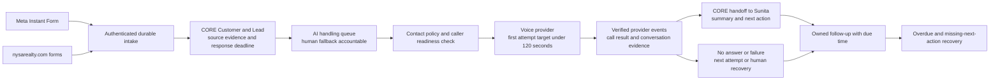

# NYSA-CRM-20261026-LEAD-001 — AI-first lead response and follow-up

Status: implementation brief and gap audit prepared; live provider accounts/connections are not configured. No live lead intake, calls, messages, provider signup or production mutation has been performed for this request.

## Confirmed user outcome

Meta Instant Form leads and nysarealty.com website enquiries must reach authoritative NYSA CORE records. AI handles the initial enquiry, initiates the first eligible contact attempt within two minutes, verifies the submitted contact/intent through conversation, and hands the lead to Sunita Sinha. Sunita is also the human fallback when AI cannot complete the first contact. Current Meta lead notifications arrive over WhatsApp; website and Property Finder enquiries currently arrive through REM. The user clarified that CORE replaces REM: no REM interface, connector, webhook/API dependency or ongoing synchronization is required. User reports that Make, 360dialog and Retell/Vapi accounts have not yet been created.

The first pilot covers Meta Instant Forms and direct server-side nysarealty.com website enquiries into CORE. Property Finder, when included, must use a direct source-to-CORE adapter rather than a REM bridge. Existing delivery must not be disabled until the replacement has passed acceptance and the cutover is approved. Historical REM data import, service cancellation and WhatsApp number migration are separate decisions, not prerequisites for building these direct integrations.

## Reproducible baseline and separation

- Development copy: isolated managed worktree from origin/main commit 4f1034167c591acb87fe9c025af48835d58630e3, tree 2416fe6856c2e4417ae1dc4dbae6d0c7ee87aaaf, source equivalent to deployed RC1 b6e013c51f46be482858e733160fa7e675ff3106.
- Production: active 2.1.0-rc.1, migration 140; CRM Test: DEV239, migration 140. The committed BASELINE.md in this clean main copy predates the observed RC1 deployment; release evidence and the original chat's updated baseline establish current production state.
- Existing paired RC1 predeployment backup and subsequent private single-account snapshot remain recovery evidence for their respective operations. They are not fresh backups for this feature's future rollout.
- Target now: local development and synthetic tests. No database copied or schema changed for this audit. Rollback for this isolated code/design work is the clean main commit above.
- Held Admin invitation change NYSA-CRM-20261026-ADM-001 remains separate and awaiting deployment. Do not bundle it into this feature.

## Intended operating loop

AI handling ownership is an automation state, not a fabricated staff account or an Admin with sales privileges. CORE remains authoritative for customer matching, lead lifecycle, assignment, contact restrictions, qualification and compliance. Sunita must resolve to an approved active operating identity; do not create accounts or change her role/team implicitly. Any existing human-owned lead requires deliberate takeover approval before AI starts contacting it.

AI verification in this pilot means the person confirms contact details, enquiry authenticity and declared requirements. It does not mean identity/KYC, payment ability, suitability, property eligibility or a compliance decision. Store declared facts and evidence separately from human-confirmed facts. AI scoring is advisory and does not replace the existing governed qualification model or its Hot/Warm/Cold classification.

## Existing code that should be reused

| Capability | Evidence in main | What remains |
|---|---|---|
| Signed website intake | src/routes/website-intake.js; POST /api/intake/website; HMAC timestamp/raw-body checks, 256 KiB limit | Connect actual website forms directly to CORE; short initial forms must be retained when classification is incomplete |
| Customer matching and enquiry deduplication | normalized phone/email, contact_channels, website_intake_events, identity/duplicate review | Namespace source events for Meta; preserve distinct enquiries for one person; test simultaneous delivery |
| Team routing and response clocks | routing-service.js, lead_assignments, SLA policies and recovery queue | Add explicitly approved AI-first processing and handoff without replacing existing assignment rules |
| Tasks, calls and next action | src/routes/crm.js and src/routes/lead-operations.js | Correlate provider outcomes and ensure every nonterminal result has a next action or visible exception |
| AI suggestions | src/routes/ai.js and src/ai-service.js | Existing implementation is advisory OpenAI-backed; it is not an autonomous calling agent or a Claude/Make connector |
| WhatsApp communication model | src/communication-domain.js, disabled connector and local simulator | No live provider adapter or runtime dispatch is wired; do not call a disabled scaffold a live channel |
| Website mapping | docs/RELEASE_3A_WEBSITE_TO_CRM_TEST_FIELD_MAPPING.md | Existing design inspected Advisor, Brochure, AI Advisory and AI Property Selection forms; live wiring still needs proof |
| Calendar integration | src/routes/integrations.js | Reuse governed meeting records; confirm the actual connected calendar and permission before booking |

Important existing boundary: website intake accepts only source Website. Sending Meta events to it with a forged Website source would lose attribution and is not an acceptable shortcut. Its current validation also expects requirement purpose/timeline, explicit consent evidence and a recognized business type. A new first-contact lead with unknown facts must be retained as incomplete, not silently labelled Sale or assigned invented answers.

## Two-minute target and failure recovery

- Measure source-created time, CORE durable-received time, dispatch requested time, provider acceptance, dial started, answered, call ended and human handoff separately.
- A target is a first eligible attempt within 120 seconds of source submission. An API HTTP 200 or a queued call is not proof of ringing, answer, conversation or verification.
- A late upstream notification must retain the original timestamp and expose transit delay. Do not restart the clock at zero on arrival to hide a breach.
- Meta and website ingestion use immediate event delivery with durable local/provider retry. Monitor reconciliation to find source events missing from CORE. Reconciliation frequency is configured from the two-minute objective, rate limits and available plans; do not assume a default slow polling schedule meets it.
- CORE persists the lead plus automation outbox/job in one transaction. Dispatch uses a stable attempt key, a lease and retries with backoff. A crash after dispatch but before acknowledgement becomes outcome_unknown and must be reconciled before redialling.
- A watchdog alerts the human fallback before/at breach even if Make or the voice provider is unavailable. Its recovery path must not depend solely on the failed Make scenario. Alert-delivery channel remains to be selected and tested.
- No answer, busy, failed dial and disconnection are distinct from successful contact. They create a recorded outcome and an explicit next attempt or human task. Do not mark Contacted or set first_contact_at for a call that never connected.
- AI cannot keep a lead indefinitely. Handoff must create an owned task and due time, and agent acceptance is recorded. Rejected/unaccepted handoffs remain visible to the fallback.
- Human takeover, opt-out, do-not-contact or a terminal CRM decision cancels undispatched attempts. Already dispatched calls require provider cancellation/stop reconciliation; database state alone cannot prove a remote call stopped.
- Existing Contacted stage alone is not a reason to discard all future follow-ups: stop the initial AI sequence on human takeover, but preserve the next agreed action and its owner.

## Required user-facing work queues

1. New leads awaiting AI: source, original arrival, countdown and fallback.
2. AI contacting: attempt state and last provider update, with timeout warning.
3. AI checked / ready for Sunita: concise evidence summary, missing answers, recommended next action and handoff age.
4. No answer / retry due: attempt count, latest result and next action time.
5. Human follow-up: owned task, due time, last interaction and completion/outcome control.
6. Needs attention: invalid number, identity conflict, missing mapping, missing caller permission, source/provider failure, unknown call outcome or missing next action.

Every row must resolve to CORE's authoritative lead and activity timeline. Counts must drill into the same records. Admin maintains connector settings and sees integration health; operating users handle the lead work.

## Provider setup and connection order

1. Confirm Meta Page/form access and lead retrieval permissions, create a Meta developer/business integration and prove one synthetic test-lead round trip. Capture leadgen_id, page/form/ad/campaign identifiers and original submission time. A WhatsApp notification is not the authoritative lead record.
2. Connect nysarealty.com forms directly through a server-side WordPress adapter to the authenticated CORE intake boundary. Preserve original source IDs, form/property references, consent evidence and source-created timestamps; provide durable retry when CORE is unavailable. Validate one primary CORE ingress path and prevent duplicate enquiry creation during cutover. Do not build a REM adapter or scrape its notifications.
3. Configure an NYSA-owned Make account/workspace if Make is retained. Keep secrets in protected server/account connections, define error handlers and incomplete-execution recovery, and minimize customer content in third-party execution logs. CORE retains durable work and reconciliation authority.
4. Select Retell or Vapi after validating the approved NYSA caller ID/telephony route and the markets to be called. Create the provider account, verified caller route and a versioned pilot agent; test on explicitly approved team numbers before any real lead. Do not assume purchasing a generic number enables the required local caller identity or destination coverage.
5. Add 360dialog only for automated WhatsApp conversations/templates. Its shared-number migration from REM needs a separate cutover plan and approval. Do not disable two-step verification, share a PIN, migrate the number or cancel REM based only on the attachment.
6. Reuse an existing approved CRM AI model unless a separate Claude requirement is confirmed. A voice agent's model, CRM advisory model and Make orchestration are different responsibilities; unnecessary duplicate accounts are not prerequisites.

None of these accounts exists according to the user yet. Connector-directory discovery did not return a direct installed Make/Meta Lead Ads/360dialog/Retell/Vapi integration capable of completing this setup. Account creation, sign-in, permissions, payment and any terms acceptance must be completed through the applicable approved flows. No service account was created in this task.

## Contracts to implement

- Versioned inbound enquiry envelope: source_system, source_event_id, source_created_at, received_at, schema_version, contact claims, campaign/form/page/ad metadata, original answer evidence and channel/contact-permission evidence. Resolve links only inside CORE.
- Provider-specific authenticated inbound adapters: Meta verification/signature/lead retrieval and direct website server signing. A later Property Finder adapter is source-to-CORE; there is no REM adapter.
- Scoped outbound work: opaque CORE job/lead references, approved channel/purpose, minimal context, permitted actions, deadline and dispatch eligibility. Never expose full customer/profile/documents by default.
- Narrow result commands: report attempt status, submit conversation/qualification evidence, request handoff, record opt-out and request a governed meeting. Avoid arbitrary PATCH-any-lead APIs or stage/ownership changes supplied by third parties.
- Events: lead.intake_accepted, ai_triage.requested, attempt.accepted/started/ended/analyzed, handoff.requested/accepted, followup.scheduled/due and exception.raised. Each has its own immutable event ID and schema version.
- Validate provider signatures, replay limits, job binding, source/tenant binding and idempotency. Acknowledge only after durable receipt; process asynchronously. Duplicate or out-of-order callbacks cannot reopen cancelled work, create duplicate activities, regress a completed result or overwrite human decisions.
- Restricted conversation/recording storage with explicit retention and access policy. General audit/error logs contain opaque references, status and safe failure codes, not phone numbers, email addresses, secrets, recording URLs or transcripts.

## Acceptance matrix before any go-live

| Scenario | Required evidence |
|---|---|
| Meta Instant Form test lead | One CORE lead/customer, original attribution, AI job and deadline; first allowed attempt within target |
| Website Advisor/Brochure/AI form | Original fields and evidence retained, no invented missing classification, source event recoverable after CRM outage |
| Duplicate notification/replay | Same result, no second customer, lead, call or task |
| Same person, different enquiry | Reuse customer; retain the distinct enquiry under duplicate policy |
| No answer/busy/provider failure | Correct activity outcome and owned next action; no false successful first contact |
| Crash after provider acceptance | Unknown-outcome reconciliation; no blind duplicate call |
| AI conversation completed | Summary and declared facts on correct lead; no KYC claim or automatic qualification override |
| Handoff to Sunita | Existing approved operating identity, correct owner/task/deadline, recorded acceptance |
| Missing owner/invalid configuration | Visible recovery item and fallback alert, not an orphaned lead |
| Human takes over while AI queued | Pending actions cancelled; race rechecked before dispatch |
| Opt-out before/during call | Restriction retained; further dispatch stopped and provider outcome reconciled |
| Expired/replayed/bad callback | Denied or safely deduplicated; no CRM data mutation |
| Source event missing from CORE | Reconciliation finds it and safely retries without duplicate work |
| Make/AI unavailable | Lead and deadlines remain visible; independent fallback works |
| Restart and concurrent workers | Durable recovery and one active attempt lease |
| Permissions and privacy | Admin configuration role separate; agents/team scopes preserved; no customer secrets/content in logs |

## Decisions still needed before live activation

- Confirm the exact nysarealty.com form/plugin hooks and WordPress staging access for direct delivery. REM vendor/API discovery is not required.
- Sunita's active CORE operating identity and team/routing context, verified without changing existing assignments.
- Voice provider, approved caller number/telephony route, destination coverage and account budget.
- Pilot calling hours/timezone, customer contact permission and recording/retention requirements.
- Follow-up cadence, retry limits, handoff/acceptance target and independent fallback alert channel. These are not silently invented from the two-minute first-contact target.
- Approved synthetic/team test numbers, service accounts and exact sandbox/staging rollout.

## Clarification — CORE replaces REM

The user explicitly confirmed this architecture on 26 October 2026. REM is the current system being replaced, not an integration layer. The pilot path is Meta Instant Forms / nysarealty.com → CORE → AI response → Sunita → CORE follow-up. Remove REM API discovery from the critical path. Do not infer authorization to cancel REM, migrate historical records, disable existing delivery or move the WhatsApp number from this clarification.

## Delivery gates

A: source contract/field mapping and CRM-native queue/outbox design. B: local implementation with synthetic source/provider emulators and failure/recovery tests. C: NYSA-owned provider accounts and isolated sandbox round trip. D: GitHub PR, origin-only candidate package and CRM Test end-to-end acceptance. E: exact-version production approval, fresh paired backups and encrypted recovery copy, controlled activation and monitoring. No production schema, connector, calling configuration or real outbound activity is authorized by completing this brief.

## Primary references checked

- User-supplied NYSA_CORE_Integration.md (requirements input; its embedded migration/cancellation instructions are not execution authorization).
- Meta-owned lead retrieval checker: https://github.com/facebookincubator/catalogue-of-api-solutions/blob/main/solutions/leads/leads-retrieval-set-up-checker.md
- Meta retrieval documentation: https://developers.facebook.com/docs/marketing-api/guides/lead-ads/retrieving/ (rate limited during this audit; no permission-change assumptions made).
- Retell call API: https://docs.retellai.com/api-references/create-phone-call
- Retell webhook lifecycle: https://docs.retellai.com/features/webhook-overview
- Make webhook processing: https://help.make.com/webhooks
- 360dialog webhook delivery: https://docs.360dialog.com/docs/messaging/webhook

## Detailed design for review

See [Detailed design v1.0](NYSA-CRM-20261026-LEAD-001-DETAILED-DESIGN-v1.md) for state transitions, source mappings, contracts, data design, controls, acceptance tests and decision register. Status: FOR REVIEW; implementation has not started.

## Business review revision 27 October 2026

[Detailed design v1.1](NYSA-CRM-20261026-LEAD-001-DETAILED-DESIGN-v1.1.md) incorporates multichannel Meta canary, booking, tiered handoff, international route gate, proposed rubric and effort estimate. FOR SIGN-OFF; build remains on hold. Website follows canary. v1.0 retained as history.

## Build approval 27 October 2026

[Approved build reference v1.2](NYSA-CRM-20261026-LEAD-001-DETAILED-DESIGN-v1.2.md): user signed off v1.1 and confirmed UAE/India-only pilot. Nonvoice build approved; voice waits for two-provider UAE/India route gate. Live activation, UAT owner and canary size remain separate approvals. Prior versions retained.

## Nonvoice build started 27 October 2026

[Increment 1 status](NYSA-CRM-20261026-LEAD-001-BUILD-PROGRESS.md) and [UAE/India call-test setup](NYSA-CRM-20261026-LEAD-001-CALL-TEST-SETUP.md). Meta reference inbox and policy foundation implemented with 26 targeted tests passing; no live connectors or deployment.

## Complete sign-off received 27 October 2026

Full attachment supersedes the incomplete note. v1.2 now incorporates explicit Q4–Q7 decisions, approved rubric, 8-minute calls, USD 10/day messaging cap, 24-hour chat/10-reply rule and UAE/India-only timezones. Policy tests updated: 29 pass; no migrations applied or live activity.
