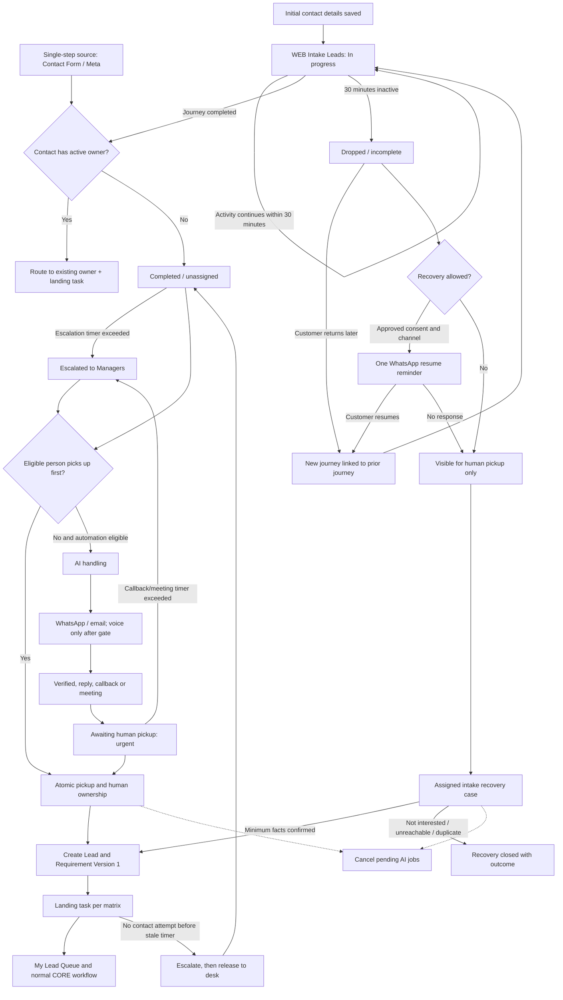

# NYSA CORE — WEB Intake Leads lifecycle, pickup and AI response

**Detailed requirements and proposed design v1.3 · 29 October 2026** (developer copy; supersedes all earlier versions)  
**Reference:** NYSA-CRM-20261028-LEAD-003  
**Status:** Business workflow and first-release settings agreed. Proposed technical design for review before implementation  
**Proposed target:** CRM Test and the staging website test path only  

## 1. Document control and safety boundary

This document records the business direction agreed on 28 October 2026 and proposes the technical design required to implement it. It does not authorize a code deployment, database migration, provider activation or production change.

The source baseline used for this design is Git commit `73be0189df51858831b32e178163fbc1a7258779`, tree `7677b771857f93a03cc127b7e7a2f93a616af6a1`, branch `codex/incoming-leads-dev246`, advertised by `origin/codex/incoming-leads-dev246`. The latest committed environment baseline describes the DEV246 Incoming Leads candidate against CRM Test DEV245. The actual installed CRM Test version, database migration level, files, integration flags and rollback evidence must be freshly observed before implementation or deployment.

This is a documentation-only change. No database, configuration, application runtime, website, provider account or customer record is changed. The rollback point for this document is the source commit above; removal or reversion of this document fully reverses this documentation change. Fresh paired CRM Test/staging backups and a verified encrypted private off-server copy remain mandatory before a future deployment. Production remains outside scope and unchanged.

### 1.1 Version history

| Version | Date | Summary |
|---|---|---|
| 1.0 | 28 October 2026 | Initial agreed workflow and proposed design |
| 1.1 | 29 October 2026 | Landing tasks, escalation, stale ownership, pickup cap, repeat-contact routing, journey/case state split |
| 1.2 | 29 October 2026 | Provisional identity, single primary next action, routing past the cap, escalation fallback; first-release business decisions |
| 1.3 | 29 October 2026 | Primary-task scoping, matching hashes, contact window, AI wording, retention and exception queue |

This document is the complete current design. Earlier versions are superseded and do not need to be read. Approved settings for the first release are listed in Section 18.

## 2. Problem statement

The present implementation mixes four different concepts:

1. a customer entering initial details on the website;
2. a customer completing or abandoning a website/NIA journey;
3. a governed CORE Lead and its structured requirements; and
4. the operational work required to contact and follow up with that Lead.

This causes the following user-visible problems:

- provisional NIA answers can become Lead Requirement Version 1;
- later completed answers can appear as a second requirement version even though the customer has not changed an established Lead requirement;
- a canonical Lead can be created before the digital intake is complete or picked up;
- the Incoming Leads and Lead Response screens overlap without explaining their separate purposes;
- the Lead Response screen presents abstract ratios and technical workflow states instead of an agent's actionable queue;
- incomplete customers are not represented clearly as a recoverable intake category; and
- AI handling, automatic follow-up and human pickup do not have one simple, race-safe ownership rule.

Requirement versioning must describe genuine changes to an established Lead. It must not be used as website step history.

## 3. Confirmed business requirements

| ID | Requirement |
|---|---|
| WEB-001 | Rename the shared digital intake workspace to **WEB Intake Leads**. |
| WEB-002 | WEB Intake Leads covers website Contact Form, NIA, Meta Instant Forms and other governed digital intake sources. Source and campaign remain explicit filters. |
| WEB-003 | A manager review is not required before pickup. Any active, eligible Sales Agent or Manager with intake permission may pick up an unassigned item. Admin is not treated as an ordinary sales role. |
| WEB-004 | Pickup is the operational acceptance action. A successful pickup assigns the item to that person and moves it to their queue. |
| WEB-005 | Pickup must be atomic. If two eligible users act concurrently, only one succeeds; the other is told who already owns the item. |
| WEB-006 | Initial customer details are saved as an intake journey, not immediately represented as a final Lead requirement. |
| WEB-007 | A website journey remains resumable for 30 minutes after the latest customer activity. |
| WEB-008 | After 30 minutes without activity, an unfinished journey becomes **Dropped / incomplete** in WEB Intake Leads. It is not presented as a completed Lead. |
| WEB-009 | A customer returning after the 30-minute window starts a new journey linked to the prior dropped journey and matched contact. The expired journey remains immutable audit history. |
| WEB-010 | Completed but unassigned intake remains in WEB Intake Leads. It does not enter the normal Leads pipeline until pickup. |
| WEB-011 | A completed intake picked up by an eligible person becomes a governed CORE Lead, receives its initial structured Requirement Version 1 and enters normal CORE workflow. |
| WEB-012 | A dropped/incomplete intake may be picked up for recovery and moved to the person's queue, but it is not promoted to a canonical Lead until sufficient interest and requirements are confirmed. Unknown facts remain unknown. |
| WEB-013 | The current **Lead Response** workspace is renamed **My Lead Queue** and redesigned around actionable assigned work. |
| WEB-014 | AI is a processing state, not a fabricated employee or sales owner. Human pickup always takes priority and stops pending AI outreach. |
| WEB-015 | No automatic outbound contact occurs while the customer is actively completing the journey. |
| WEB-016 | A completed, eligible and unassigned intake may enter AI handling. The two-minute first-contact target starts at completion, not at initial partial capture. |
| WEB-017 | A dropped/incomplete intake may receive one approved WhatsApp resume reminder when valid contact details, permission, country/timezone and channel eligibility exist. It does not receive an automatic call merely because it was abandoned. |
| WEB-018 | If a customer replies while no human owns the item, AI may continue the bounded conversation to arrange a callback or meeting. Human pickup, opt-out, wrong-person evidence or a restriction stops AI. |
| WEB-019 | Voice remains gated by the separately approved UAE/India route tests. Until that gate passes and activation is separately approved, WhatsApp and email are the only proposed automated customer channels. |
| WEB-020 | Existing users, passwords, teams, manager relationships, customer assignments and production configuration must remain unchanged. |
| WEB-021 | Every pickup and every promotion creates exactly one open primary next-action task whose type and due time follow the landing task matrix (Section 5.6). |
| WEB-022 | A completed intake, callback request or meeting request not picked up within its escalation timer notifies the responsible Managers and is shown as **Escalated**. |
| WEB-023 | A picked-up item with no logged contact attempt within the stale-ownership timer is escalated and, if still untouched, released back to WEB Intake Leads with audit. |
| WEB-024 | A person may hold only a limited number of picked-up items with no contact attempt. Further pickup is blocked until existing items are actioned. |
| WEB-025 | AI may capture a customer's preferred callback or meeting time. A meeting is confirmed to the customer only when a human owner or an approved pool calendar slot exists. |
| WEB-026 | A new journey for a contact who already has an active owned case or open Lead is routed to that owner as new evidence and a task. It is not placed on the shared desk for a second owner. |
| WEB-027 | Single-step sources (Contact Form, Meta Instant Forms) create journeys directly in the completed state and are never subject to the 30-minute inactivity rule. |
| WEB-028 | An incomplete intake recovery case is promoted only when the defined minimum facts are confirmed, and is closed with a governed outcome otherwise. |
| WEB-029 | Speed-to-lead and intake funnel reporting is measured from journey completion and includes intake never promoted to a Lead. |
| WEB-030 | Journey start is protected against automated and abusive submissions; invalid records are marked with a governed reason, not deleted. |
| WEB-031 | An incomplete journey stores a provisional identity claim, not a new canonical Contact. A Contact is created or confirmed only on completion, pickup or verified reminder reply. |
| WEB-032 | A follow-up case has at most one open **primary next-action task** at any time, including during promotion and owner routing. Other task types are not limited by this rule. |
| WEB-033 | Repeat-enquiry routing to an existing owner is not blocked by the pickup cap. Unavailable or overloaded owners trigger immediate escalation without automatic reassignment. |
| WEB-034 | Every escalation resolves to a recipient through a fallback chain ending in a visible configuration exception in the shared Administration – Intake Configuration queue. |
| WEB-035 | For recovery promotion, **Not sure yet** confirmed by the customer is a valid answer for budget and timing. |
| WEB-036 | The first release operates without a shared booking calendar and without an on-call Manager. |
| WEB-037 | Outbound customer contact occurs only 09:00–21:00 customer-local time, or within a stricter channel/country window where one applies. |
| WEB-038 | Unresolved provisional identity claims are de-identified after 30 days; non-personal audit and funnel evidence is kept. |

## 4. Terminology and authoritative records

| Term | Meaning | Authoritative location |
|---|---|---|
| Contact | The matched person and governed contact channels. | CORE Contacts |
| Provisional identity claim | Contact details declared during a journey that has not yet been completed, picked up or verified. It is not a Customer record. | New governed provisional identity record linked to the journey |
| Intake journey | One customer attempt to complete a website, NIA or other digital intake. | New governed intake journey record linked to existing intake evidence |
| Intake snapshot | A timestamped, source-attributed capture of declared answers during a journey. | Restricted evidence plus minimized structured declarations |
| Dropped / incomplete | A journey that did not complete within 30 minutes of the latest activity. | WEB Intake Leads; not the normal Leads pipeline |
| Completed intake | A journey that reached the approved completion boundary with its final source payload. | WEB Intake Leads until pickup |
| AI handling | Automation is actively acknowledging, verifying or arranging a callback/meeting. It is not Lead ownership. | Follow-up case and job state |
| Pickup | An eligible person atomically accepts responsibility for the intake. | Audited CORE assignment transaction |
| Intake recovery case | Assigned work for a dropped/incomplete journey that has not yet become a canonical Lead. | My Lead Queue |
| Lead | A governed sales Lead created after completed intake pickup or confirmed recovery. | CORE Leads |
| Requirement Version 1 | The initial structured requirement created at Lead promotion. | CORE Lead Requirements |
| Later requirement version | A genuine post-promotion change to the Lead's requirements. | CORE Lead Requirements with supersession history |
| Follow-up case | The single operational record that holds ownership, AI state, generation and next action for one journey chain. | Generalized follow-up case (Section 8.3) |
| Landing task | The first primary next-action task created at pickup, promotion or owner routing. | CORE Tasks linked to the follow-up case |
| Primary next-action task | The single task that says what the owner must do next to move the customer forward (call, reply, confirm meeting, qualify). It drives queue sorting, escalation and stale-ownership timers. | CORE Tasks with `is_primary_next_action = true` |
| Supporting task | Any other task on the case or Lead, for example document collection, compliance checks or viewing logistics. Not limited to one and does not drive escalation. | CORE Tasks |
| Journey chain | A dropped journey and every later journey linked to it by predecessor. | `web_intake_journeys.predecessor_journey_id` |
| Escalated | An item that has exceeded its pickup or stale-ownership timer and has been notified to Managers. | Follow-up case escalation fields |
| Contact attempt | A logged human call, WhatsApp, email or meeting action toward the customer. Viewing the record is not an attempt. | CORE Activities |

CORE remains authoritative for identity, Leads, requirements, assignment, eligibility, restrictions, tasks, inventory and compliance. The website, NIA, Meta and provider systems are evidence sources and delivery channels; they do not become competing authorities.

## 5. End-to-end lifecycle

### 5.1 In-progress journey

- The first accepted contact step creates one intake journey and one **provisional identity claim** holding the declared, normalized contact details. It does not create a canonical Contact.
- The provisional claim is matched read-only against existing Contacts using keyed matching hashes of the normalized phone and email (Section 8.7), never by decrypting stored values. A deterministic match is recorded as `matched_contact_id` so that repeat-contact routing (Section 5.8) and consent checks can use it; the existing Contact is not modified.
- The provisional claim is resolved to a canonical Contact (existing match or newly created) at the first of: journey completion, pickup, or a verified customer reply to the recovery reminder from the same channel. Otherwise it expires under the approved retention policy.
- The website receives an opaque, expiring resume token; no CORE identifiers or personal data are exposed in the URL.
- Each accepted step is idempotent and updates the journey's `last_activity_at` and `resume_expires_at`.
- The 30-minute period is measured from the latest accepted customer activity.
- No automatic outbound call, WhatsApp or email is triggered while the journey is in progress.
- Source answers are treated as untrusted declarations and retained with source, form version and time.

**Single-step sources.** Contact Form and Meta Instant Forms deliver a complete submission in one event. Their identity is resolved to a canonical Contact immediately after validation. They create a journey directly in the `completed` state with `started_at = completed_at` and no resume token. The 30-minute inactivity rule and dropped state do not apply to them. Any other source must declare in its source mapping whether it is single-step or multi-step; an undeclared source is placed in **Needs attention**.

### 5.2 Dropped / incomplete journey

- A supervised worker changes an unfinished journey to `dropped_incomplete` after 30 minutes without activity.
- The resume token for that journey is no longer valid.
- The intake remains visible in WEB Intake Leads with the information captured so far, missing-field summary, source and campaign.
- The abandoned journey is not inserted into `lead_requirements` and does not appear in the normal Leads pipeline.
- One WhatsApp recovery reminder may be queued only when all permission and eligibility checks pass. It contains a secure link that begins a new linked journey.
- **Reminder timing:** the reminder is scheduled for the drop time plus a recovery delay (approved value 30 minutes, so roughly one hour after the last activity), moved to the next allowed local-hours window when needed. It is not sent if the contact has started a new journey or has been picked up in the meantime.
- **Prefill:** the new linked journey is prefilled from the predecessor's latest snapshot so the customer does not start over. The predecessor snapshot stays immutable; the new journey records which answers were carried forward and which were re-confirmed.
- No automatic voice call is permitted for abandonment alone.
- A dropped journey keeps its provisional identity claim and does not create a Customer record. The recovery reminder is allowed only when consent and channel eligibility are evidenced for the provisional claim or its matched Contact.
- If a person picks up the dropped intake, CORE creates an assigned intake recovery case. It becomes a Lead only after the customer confirms interest and sufficient structured requirements are obtained.

### 5.3 Completed, unassigned intake

- Completion freezes a final intake snapshot, sets the journey to `completed` and, after the Section 5.8 routing check, opens a follow-up case in the `unassigned` state (Section 8).
- Completion does not itself assign a human owner or create a Lead Requirement version.
- The record becomes immediately available for pickup in WEB Intake Leads.
- If channel, consent, country/timezone, restriction and provider gates pass, the intake may also enter AI handling.
- The first-contact target is measured from `completed_at`.

### 5.4 Human pickup

Pickup is one audited database transaction:

1. lock the intake journey and linked follow-up case;
2. verify the item is still unassigned and the actor remains eligible;
3. record the human owner and pickup time;
4. increment the automation generation;
5. cancel or invalidate undispatched AI jobs;
6. record an immutable audit event;
7. for completed intake, create or idempotently reuse the canonical Lead;
8. create Requirement Version 1 from the final structured intake snapshot;
9. create exactly one landing task according to the landing task matrix (Section 5.6), start the stale-ownership timer, and expose the item in My Lead Queue; and
10. return the resulting Lead/case references.

Step 2 also checks the pickup cap (Section 5.7). A pickup refused by the cap returns a clear message listing the person's uncontacted items.

Already-submitted provider operations that cannot be cancelled immediately remain `stop_requested` until reconciled. Late callbacks may append evidence but cannot restore AI control or overwrite the human owner.

### 5.5 CORE workflow after pickup

Once a completed intake is picked up, normal CORE governance applies: Lead stage, structured requirement confirmation, activities, tasks, SLA, matching, opportunity readiness and compliance. WEB Intake Leads retains the item under **Assigned** for traceability but is not a second sales pipeline.

For a dropped intake recovery case, the assigned person works from My Lead Queue. When the customer confirms the enquiry and missing minimum facts, one governed promotion transaction creates the Lead and Requirement Version 1. No fabricated default requirement values are allowed.

### 5.6 Landing task matrix

Every pickup, recovery promotion and owner routing creates exactly one open landing task. The task type and due time depend on the situation at the moment of landing. Where several apply, the highest row in the table wins.

| Priority | Situation at landing | Landing task | Due (approved value) | Task must show |
|---|---|---|---|---|
| 1 | Meeting requested through AI or form | Confirm meeting with customer | 15 minutes from pickup, and always before the requested slot | Requested slot, customer timezone, AI summary, property/area interest |
| 2 | Callback requested | Call back | The requested time; if none or already passed, 15 minutes from pickup | Requested time, preferred channel, AI summary |
| 3 | Customer replied to AI, no booking | Reply to customer | 30 minutes from pickup | Last customer message, full AI conversation summary, open questions |
| 4 | Completed intake, AI contacted but no reply | Personal follow-up | 2 business hours from pickup | AI messages sent and their delivery evidence |
| 5 | Completed intake, no AI contact (not eligible or voice-only gap) | First contact | 15 minutes from pickup | Reason AI did not contact, permitted channels |
| 6 | Dropped/incomplete recovery case | Recovery contact | Same business day; next business morning if picked up after hours | Answers so far, missing minimum facts, whether the reminder was sent |
| 7 | New journey routed to existing owner (Section 5.8) | Review new enquiry | 2 business hours from routing | What changed versus the existing Lead/case; prompt to decide whether a new requirement version is needed |
| 8 | Recovery case promoted to Lead | Qualify Lead | Next business day | Requirement Version 1 and any facts still unknown |

**Task rules**

- All due times respect the customer outbound contact window (09:00–21:00 customer-local, or a stricter Section 6.5 rule) and the owner's existing CORE employee working hours. A task is due only when both windows are open. If the due time falls outside them, the task is due at the start of the next time both are open and is marked **Due at open**.
- Completing a landing task requires a logged outcome: contacted, no answer, left message, wrong number, opted out, meeting confirmed, callback rescheduled or not interested.
- **Single primary next action:** a follow-up case has at most one open **primary next-action task** at any time. Any operation that would create a primary task (pickup, promotion, routing, outcome recording) first closes or updates the existing open primary task in the same transaction. Two competing primary next actions are never valid. Supporting tasks (documents, compliance, viewing logistics) may be open alongside it and are unaffected.
- An outcome other than a terminal one automatically creates the next task. Attempt cadence when there is no answer: retry after 2 hours, then next business day, then 2 business days later. After the fourth unanswered attempt the item moves to **No response** and the owner chooses to close or continue.
- A task missed by its due time appears under **Overdue** in My Lead Queue. A task overdue by more than the stale-ownership timer triggers Section 5.7 escalation.
- The AI conversation summary and next-step recommendation are attached to the task. The agent must not need to re-ask questions the customer already answered.
- Booking, callback and meeting times are stored with the customer timezone and displayed in both customer and owner time.

### 5.7 Unpicked work, stale ownership and fair pickup

**Pickup escalation timers** (measured within business hours, meaning the existing CORE employee working hours for the intake scope, unless stated)

| Item | Escalation timer (approved value) | Escalates to | Effect |
|---|---|---|---|
| Completed, unassigned | 15 minutes from `completed_at` | Managers for the intake scope | Shown as **Escalated**; Manager notified; any eligible person may still pick up |
| Callback or meeting requested, unassigned | 10 minutes from the request, and always 30 minutes before a requested slot | Managers for the intake scope | Shown as **Urgent**; repeat notification every 10 minutes until picked up |
| Dropped/incomplete, unassigned | 1 business day from `dropped_at` | Managers for the intake scope | Shown as **Escalated** |
| Needs attention exception | 1 business day | Configured exception owner | Shown with exception owner name |

A Manager receiving an escalation may pick up the item or assign it through the existing governed manager workflow. Escalation never auto-assigns to a person.

**Stale ownership.** If a picked-up item has no logged contact attempt within the stale-ownership timer (approved value 30 minutes after the landing task due time), the owner and their Manager are notified. If there is still no attempt after a second timer (approved value a further 60 minutes), the item is released back to WEB Intake Leads as **Released**, with the previous owner, reason and timestamps recorded in the audit event. The released item keeps its AI history but AI does not restart automatically; a new pickup is required.

**Pickup cap.** A person may hold at most N picked-up items with no contact attempt (approved value 5). The cap is checked in the pickup transaction. Managers may raise an individual's cap through governed configuration.

**Out of hours.** Outside the configured business hours, AI handling of eligible completed intake continues under Section 6. All escalation timers pause and resume at the next business opening. The first release has **no on-call Manager**. At the start of each business day, Managers receive a summary of items waiting from out of hours, with callback and meeting requests listed first. Business hours are configured per intake scope and must reflect actual enquiry patterns, including evening hours for GCC and India customers. An on-call option may be added in a later release.

**Escalation recipient fallback.** Each escalation resolves its recipient in this order:

1. the active Managers configured for the intake scope;
2. the active Managers of the parent team; and
3. if neither exists or all are inactive, a **configuration exception** in the shared **Administration – Intake Configuration** queue, visible to all active Admins. Any active Admin may resolve it by correcting the configuration; resolution is audited. If no active Admin exists, the exception remains open and visible on the desk; it is never dropped.

While an item is in the configuration exception path it stays visible on the desk with the flag **No escalation recipient**, remains available for pickup, and appears in Needs attention. An item can never become silently unowned or hidden.

**Approval status.** The timers, cap, release periods and attempt cadence in this section and Section 5.6 are approved for CRM Test UAT only. They must be reviewed against UAT evidence and re-approved before any production change request.

### 5.8 Repeat contact routing

When a journey reaches the completed state, CORE checks the matched Contact before placing the item on the shared desk:

| Contact already has | Routing |
|---|---|
| An open Lead with a human owner | Attach the journey to that Lead as new evidence; create landing task row 7 for the owner. Do not create a new Lead or requirement version automatically. |
| An active follow-up case with a human owner (including a recovery case) | Attach the journey to that case; create landing task row 7 for the owner; cancel any pending recovery reminder. |
| An active case in AI handling only | Merge into the same case and journey chain; AI continues under the existing generation; no second case is created. |
| An open Lead whose owner is inactive, on leave or no longer eligible | Place on the shared desk flagged **Previous owner unavailable**, showing the existing Lead reference. |
| Only closed Leads or closed cases | Treat as a new enquiry on the shared desk, flagged **Returning customer** with the prior references. |
| A restriction, opt-out or wrong-person flag | Place in **Needs attention**; no automated contact. |

**Routing and the pickup cap.** Routing to an existing owner is not a pickup and is never blocked by the pickup cap. Instead, after routing:

- **Owner unavailable** (inactive, on leave or outside their configured shift at routing time): the case escalates immediately to the Section 5.7 recipient chain, shown as **Owner unavailable**. It is not reassigned automatically.
- **Owner overloaded** (owner is at or above the pickup cap **and** the routed task passes its due time with no logged action): the owner and their Manager are notified immediately, shown as **Owner overloaded**. It is not reassigned automatically.
- A Manager may reassign through the existing governed manager workflow.

**Existing open task.** If the owner already has an open primary next-action task on the case or Lead, routing does not add a second task. It updates the existing task: raises its priority to row 7 or higher as applicable, brings its due time forward if row 7 is earlier, and attaches the new enquiry details. If there is no open task, one row 7 task is created.

Routing uses the matched Contact only when the match is deterministic. An uncertain match is never auto-routed; it goes to **Needs attention** with the candidate matches listed.

Dropped journeys follow the same rule: a dropped journey for a contact with an owned case or Lead is attached to that owner as evidence and does not create a separate recovery item.

### 5.9 Recovery case promotion and closure

**Minimum facts for promotion.** A recovery case may be promoted to a Lead only when the customer has confirmed interest and the following are known (each may be a range or band but not a default):

1. enquiry purpose (buy to live, buy to invest, rent, sell, other);
2. location or area preference, or explicit "open to suggestions";
3. budget band;
4. property type; and
5. timing band.

**Not sure yet.** For budget band and timing band, a customer's explicit answer of **Not sure yet** counts as confirmed. It is stored as a distinct value `customer_undecided`, separate from `unknown` (never asked or never answered). Only `unknown` blocks promotion. Purpose, location (or explicit "open to suggestions") and property type must have a substantive answer.

Bedrooms, readiness, financing and nationality-related eligibility remain optional at promotion and are listed as unknown.

**Promotion and tasks.** The promotion transaction closes the open recovery task with outcome `promoted` before creating the **Qualify Lead** task (row 8). Both happen in one transaction; on failure neither change is kept. The minimum fact list is configuration that requires business approval to change.

**Closure outcomes.** A recovery case that is not promoted must be closed with one governed outcome: not interested, unreachable after the attempt cadence, wrong person, duplicate of another case or Lead, invalid or spam, or opted out. A closed recovery case remains visible in the Assigned/audit view and is never deleted. A later journey from the same contact follows Section 5.8.

## 6. AI, WhatsApp, email and voice design

### 6.1 Automation eligibility matrix

| Intake condition | WhatsApp | Email | AI voice | Human pickup |
|---|---|---|---|---|
| In progress, less than 30 minutes inactive | No outbound contact | No | No | No. Visible read-only in the In progress view. |
| Dropped/incomplete, permission and eligibility valid | One approved resume template | No scheduled recovery email in the first release | No | Yes |
| Dropped/incomplete, permission absent or location uncertain | No | No | No | Yes |
| Completed/unassigned, eligible in pilot country | Immediate approved acknowledgement and sequence | Approved sequence when email exists | After route gate and activation only | Yes |
| Completed/unassigned, outside/unknown pilot country | No automated contact | No automated contact | No | Yes, with visible exception |
| AI handling and customer replies | Bounded AI conversation may continue toward booking | Bounded reply handling may continue | According to approved sequence after gate | Yes; pickup stops AI |
| Human owned | Cancel pending AI sends | Cancel pending AI sends | Stop/cancel/reconcile | Already owned |
| Opted out, wrong person or restricted | Stop | Stop according to restriction scope | Stop | Human review only where required |

### 6.2 Completed-intake automation

The approved nonvoice sequence remains the governing schedule, subject to the following placement rules:

- step 0 acknowledgement begins only after journey completion;
- the two-minute AI call target begins only after completion and only once voice is separately enabled;
- before voice activation, the UI must state that voice is unavailable rather than simulate or claim a call;
- customer replies may continue as bounded AI chat toward a callback or meeting while the item remains unassigned;
- a booking or callback does not silently assign a sales owner; it makes pickup urgent and visible under the Section 5.7 timers;
- **AI captures, humans confirm:** while no human owns the case, AI records the customer's preferred callback or meeting time and tells the customer that a named adviser will confirm shortly. AI must not tell the customer a meeting is confirmed. **The first release has no shared booking calendar**, so this rule has no exception: AI records the requested time and states that an adviser will confirm it. The approved wording is: “I’ve recorded your preferred time. A NYSA adviser will confirm availability shortly.” Because out-of-hours escalations wait until the next business opening, a separately approved after-hours variant may name when the office reopens; until one is approved, the approved wording is used at all times. A future pool calendar may allow AI-confirmed slots with a mandatory assignment deadline (for example 30 minutes after booking, and always 2 hours before the slot), but only through a separate approved change;
- human pickup immediately invalidates future automation through the case generation; and
- provider acceptance is not proof of delivery, contact or customer confirmation.

### 6.3 Dropped-intake recovery

The first-release recovery rule is intentionally narrow:

- wait until the journey is formally marked dropped after 30 minutes of inactivity, then the recovery delay in Section 5.2, within local hours;
- send at most one approved WhatsApp template when a valid WhatsApp number, permission statement, supported country/timezone and unrestricted identity are evidenced;
- use an opaque, expiring resume link that starts a new journey linked to the dropped predecessor;
- do not place an automatic call or create the full three-day sequence;
- treat customer reply as engagement and allow bounded AI help to resume/complete the intake; and
- if no response occurs, leave the record visible for human pickup without silently closing it.

### 6.4 Ownership and stop rules

AI ownership is displayed as **AI handling** and never stored as an employee owner. The following events stop future automation:

- successful human pickup;
- explicit human takeover;
- opt-out or applicable restriction;
- wrong-person confirmation;
- confirmed booking when the approved policy says the initial sequence is complete;
- routing of the journey to an existing human owner (Section 5.8); or
- an ambiguous provider outcome requiring reconciliation.

All job claims must recheck generation, ownership, consent, restrictions, local hours, location, caps and provider activation immediately before submission.

### 6.5 Customer outbound contact window

- Default window for all outbound customer contact, automated or human: **09:00–21:00 in the customer's local time**, derived from the evidenced country/timezone. Contact is not attempted when the customer's timezone is unknown.
- Customer-initiated conversations: replying within an open conversation the customer started is still subject to the window for automated replies, unless a separate approved policy allows immediate replies.
- **Stricter rules win.** The window is configured per country and per channel. Where a country or channel rule is stricter than 09:00–21:00, the stricter rule applies. In particular, the UAE telemarketing regulations adopted in 2024 are widely reported to restrict marketing calls to 09:00–18:00; whether they apply to follow-up calls on a customer's own enquiry must be confirmed by NYSA's legal adviser before voice is enabled or human calls to UAE numbers are scheduled after 18:00. Until that is confirmed, the proposed UAE voice-call window is 09:00–18:00.
- Human task due times and escalation timers follow existing CORE employee working hours; a human outbound task is due only when both the employee window and the customer window are open (Section 5.6).

## 7. Proposed user interface

### 7.1 Navigation

- Rename **Incoming Leads** to **WEB Intake Leads**.
- Rename **Lead Response** to **My Lead Queue**.
- Retain **Leads** as the governed sales pipeline after pickup/promotion.
- Do not create separate top-level pages for Contact Form, NIA and Meta; they are source filters within WEB Intake Leads.

### 7.2 WEB Intake Leads

The workspace is a shared arrival, recovery and pickup desk. Recommended views:

| View | Contents |
|---|---|
| All | Every authorized intake record, one row per journey chain showing the latest journey; earlier journeys in the chain are listed in the detail timeline |
| In progress | Journey active within its 30-minute window |
| Dropped / incomplete | Journey expired before completion |
| Completed | Completed and unassigned |
| AI handling | Automation active and no human owner |
| Callback / meeting requested | AI/customer produced an actionable handoff |
| Assigned | Human picked up; retained for audit |
| Needs attention | Mapping, identity, consent, provider or reconciliation issue, each with a named exception owner |
| Escalated / Urgent | Items past a Section 5.7 pickup timer, oldest first |
| Released | Items returned to the desk under the stale-ownership rule, with previous owner shown |

Filters:

- source: All, Contact Form, NIA, Meta Instant Forms, Other;
- exact campaign, No campaign and Unmapped campaign;
- status/view;
- AI status;
- received date and age;
- search by authorized customer/contact hint, Lead reference when present or source event reference; and
- optional owner filter for Admin/Manager oversight without making manager review mandatory.

Recommended columns:

1. customer/contact hint;
2. source and form;
3. campaign;
4. journey status and progress;
5. AI status;
6. last activity/age;
7. owner or **Available to pick up**;
8. next action;
9. time to escalation, or **Escalated** / **Urgent** badge; and
10. **Review** or **Pick up** action.

Flags shown on the row where they apply: **Returning customer**, **Previous owner unavailable**, **Released**, **Callback requested**, **Meeting requested**.

The detail drawer/page shows:

- contact identity and masked channels;
- source, campaign, form and journey timeline;
- completion progress and missing answers;
- structured declarations in readable business labels;
- consent and channel eligibility;
- AI activity, next scheduled action and stop state;
- duplicate/identity/mapping warnings;
- restricted raw evidence only through an authorized audit disclosure; and
- actions: Pick up, Resume/recovery information, Mark invalid, resolve exception and open assigned queue.

The UI must not render a provisional website step as a Lead Requirement version. Only the final current structured summary is shown prominently; historical intake snapshots remain in an audit timeline.

### 7.3 My Lead Queue

My Lead Queue is the individual's actionable workspace, not a statistical report. Recommended views:

- My active work;
- Due today;
- Overdue;
- Customer replied;
- Callback requested;
- Meeting requested/booked;
- Intake recovery;
- New enquiry from existing customer (Section 5.8);
- No response; and
- Closed/completed.

The default sort is by landing task priority (Section 5.6) and then due time, so meeting and callback work always appears first.

Recommended columns:

1. customer/enquiry;
2. record type: Lead or incomplete intake recovery;
3. source/campaign;
4. current state;
5. AI/customer summary;
6. last contact;
7. next action;
8. due time; and
9. open action.

The current Contact Rate, Enquiry Confirmed, Callbacks per 10 Leads and Average Acceptance metrics are removed from the default queue header. Cohort KPIs belong in a separately defined reporting view with explicit period and denominator. The queue header may show only actionable counts such as Active, Due today, Overdue and Uncontacted pickups against the person's pickup cap (for example "3 of 5").

Completing a task from the queue opens the outcome capture defined in Section 5.6 and shows the automatically created next task before closing.

### 7.4 Empty and exceptional states

- Empty views explain what qualifies for the view and do not display unexplained dashes.
- Disabled channels say why they are disabled and do not claim readiness.
- Missing country/timezone, consent, mapping or provider setup creates a visible owned exception.
- A stale pickup attempt reports the existing owner and offers navigation to the assigned/audit view.
- A pickup refused by the cap lists the person's uncontacted items with links to action them.

### 7.5 Reporting timestamps

Because a Lead is now created at pickup, Lead `created_at` no longer reflects when the customer enquired. Reporting must therefore use:

| Measure | Start | End |
|---|---|---|
| Time to pickup | `completed_at` | `picked_up_at` |
| Speed to first human contact | `completed_at` | first logged human contact attempt |
| Speed to first automated contact | `completed_at` | first provider-accepted AI message, labelled as accepted, not delivered |
| Callback/meeting response | request time | human confirmation |
| Drop rate | journeys started | journeys dropped |
| Recovery rate | dropped journeys | later completed journey in the same chain or promoted recovery case |

Intake funnel reports start from journeys, not Leads, so that intake never picked up or never promoted is counted. These measures belong in the separately defined reporting view, not the My Lead Queue header.

## 8. Proposed data model

The final schema should be additive and use the next available migration number at implementation time. Exact names may be adjusted to repository conventions, but the following responsibilities are required.

### 8.1 `web_intake_journeys`

Proposed fields:

- `id` UUID primary key;
- `source_system`, `source_account_id`, `source_form_id`, `journey_key`;
- `predecessor_journey_id` for a post-expiry restart;
- `chain_root_journey_id` so the register can show one row per journey chain;
- `provisional_identity_id` and nullable `contact_id`, set only when the identity is resolved (Section 5.1);
- `intake_mode`: `single_step` or `multi_step`;
- `state`: `in_progress`, `dropped_incomplete`, `completed`, `invalid`;
- `invalid_reason` when state is `invalid`;
- `started_at`, `last_activity_at`, `resume_expires_at`, `completed_at`, `dropped_at`;
- `follow_up_case_id` linking to the single case for the chain;
- `prefilled_from_journey_id` and carried-forward answer list;
- `current_event_id` and `final_event_id` linking existing `website_intake_events` or the equivalent source event;
- source/campaign mapping references; and
- created/updated timestamps.

Uniqueness must prevent two active journeys for the same source journey key. A restart after expiry receives a new journey ID and records its predecessor.

**Journey and case responsibilities.** Ownership and AI state are held in one place only, so that two records never disagree:

- the **journey** records only what the customer did (started, dropped, completed, invalid);
- the **follow-up case** is the only record of owner, AI state, generation, escalation, Lead binding and promotion; and
- WEB Intake Leads views are derived from both (for example, *Completed* = journey `completed` and case `unassigned`; *AI handling* = case `ai_handling`).

### 8.2 Existing intake events and restricted evidence

- Link each website/NIA event to a journey and mark its stage as provisional or final.
- Preserve original question IDs, labels, values, form version, source time and payload digest in governed restricted evidence.
- Store only minimized structured declarations in ordinary operational tables.
- Do not duplicate personal/customer answers in campaign-reference columns or general logs.
- Keep the existing source inbox as the durable integration receipt and reconciliation boundary.

### 8.3 Follow-up cases

The present `lead_follow_up_cases.lead_id NOT NULL` model cannot represent an assigned dropped-intake recovery case without prematurely creating a Lead. The implementation should either:

1. generalize the follow-up case so it references an intake journey and has a nullable Lead until promotion; or
2. add a separate intake recovery case with the same ownership, generation, event and task controls.

The preferred design is to generalize the existing case with:

- mandatory `journey_id` (the latest journey) and `chain_root_journey_id`;
- nullable `lead_id` until promotion, with a unique journey-chain-to-Lead binding;
- nullable human owner while AI is handling; `picked_up_by`, `picked_up_at`, `promoted_at`;
- explicit `case_kind`: `completed_intake`, `incomplete_recovery` or `routed_to_owner`;
- `generation` for automation invalidation (held only here);
- `state`: `unassigned`, `ai_handling`, `awaiting_pickup_urgent`, `human_owned`, `promoted`, `released`, `closed`, `needs_attention`;
- `requested_callback_at` / `requested_meeting_at` with customer timezone, and `booking_status` of `requested` or `human_confirmed` (`pool_confirmed` reserved, not used in the first release);
- `escalation_due_at`, `escalated_at`, `stale_due_at`, `released_at`, `released_from_owner`;
- `close_outcome` for recovery and other closures (Section 5.9);
- `exception_owner` for `needs_attention`; and
- a unique active case per journey chain.

This avoids creating a false Lead simply to satisfy a queue foreign key.

### 8.4 Lead and requirement creation

- Do not insert a canonical Lead merely because an intake journey started.
- Completed intake pickup creates the Lead and Requirement Version 1 idempotently.
- Dropped-intake pickup creates an assigned recovery case; Lead promotion occurs only after confirmation.
- Requirement Version 1 uses the final or confirmed structured snapshot.
- Unknown values remain null/unknown and are listed as missing; defaults must not fabricate purpose, budget, bedrooms, timing, readiness or location.
- Later customer changes after promotion create Version 2 or higher through the existing governed requirement workflow.
- A journey routed to an existing owner (Section 5.8) never creates a requirement version automatically; the owner decides through the existing workflow.

### 8.5 Landing tasks and attempts

Landing tasks use the existing CORE Tasks model with these additional references or equivalents:

- `follow_up_case_id` and nullable `lead_id`;
- `task_kind` from the Section 5.6 matrix;
- `landing_priority` (1–8) for queue sorting;
- `due_at`, `due_basis` (pickup, requested time, routing, promotion) and `due_at_open` flag;
- `customer_timezone`;
- `ai_summary_ref` pointing to the restricted conversation summary;
- `outcome` and `outcome_at` from the governed outcome list; and
- `attempt_number` within the attempt cadence.

- `is_primary_next_action` boolean: true for landing tasks and their successors; false for supporting tasks.

Uniqueness: at most one open task with `is_primary_next_action = true` per follow-up case, enforced by a database constraint (for example a partial unique index on the case where the task is open and primary), not only application logic. The same rule applies to a Lead that has a follow-up case. Supporting tasks are not constrained by this rule. Each completed task with a non-terminal outcome creates exactly one successor task in the same transaction.

### 8.6 Configuration

All timers, caps, attempt cadence, business hours, on-call Manager, pool calendar and minimum promotion facts are stored as versioned, audited configuration per intake scope. Changes require Manager or Admin authority as defined in Section 10 and take effect for new timers only.

### 8.7 Provisional identity claims

Proposed `web_intake_provisional_identities` (name may follow repository conventions):

- `id` UUID primary key;
- normalized phone (E.164) and email (trimmed, lower-cased) and name as declared, stored encrypted with masked display values;
- `phone_match_hash` and `email_match_hash`: keyed hashes (for example HMAC-SHA-256) of the normalized values, indexed for matching;
- `match_key_version` recording which matching key produced the hashes;
- `source_system` and first journey reference;
- `matched_contact_id` (nullable) and `match_confidence`: `deterministic`, `candidate` or `none`;
- `consent_statement_ref` and permitted channels as declared;
- `state`: `provisional`, `resolved`, `expired`, `invalid`;
- `resolved_contact_id`, `resolved_at` and `resolved_by_event` (`completion`, `pickup`, `verified_reply`);
- `expires_at` set to 30 days after the latest journey activity on the claim, and `deidentified_at`; and
- created/updated timestamps.

**Matching hashes.** Encryption with random initialization produces different ciphertext for the same value, so it cannot be used to find duplicates. Matching therefore uses keyed hashes:

- The matching key is a server-side secret held in the existing secret store, separate from the encryption key, never in the database, browser, logs or release artifacts.
- The same normalization and keyed hash are computed for canonical Contact phone and email channels (additive indexed columns or a side table), so provisional claims can be matched against Contacts by hash equality.
- Plain unkeyed hashes are not used, because phone numbers can be recovered from them by brute force.
- Hashes are not shown in the UI or included in exports or reports.
- Key rotation adds a new `match_key_version`; both versions are matched until all rows are re-hashed.
- A hash match on phone or email is a candidate. Whether it counts as `deterministic` follows the existing CORE contact-matching policy; the hash only replaces how values are compared.

**Retention.** When an unresolved claim reaches `expires_at`, a supervised job removes the personal details (encrypted values, masked values, matching hashes and consent free text) and sets the state to `expired`. Retained non-personal evidence: claim ID, source, campaign mapping, journey IDs and timestamps, state history and invalid reason. Resolved claims follow the Contact's existing retention policy instead.

Rules:

- Provisional claims never appear in Customers or Contacts lists and are not searchable as Customers.
- Resolution either links to the deterministically matched Contact or creates a new Contact; it never auto-merges a candidate match.
- Resolution is idempotent and happens inside the completion, pickup or verified-reply transaction.
- A claim marked invalid (spam/bot) is never resolved.

## 9. Integration contracts and APIs

Proposed server-side operations:

| Operation | Purpose | Key control |
|---|---|---|
| Start journey | Persist provisional identity claim and source envelope | Stable source idempotency key; read-only Contact match |
| Resolve identity | Turn a provisional claim into a canonical Contact link | Only on completion, pickup or verified reply; no auto-merge |
| Save journey step | Store a provisional snapshot and extend activity window | Journey token, schema version and payload digest |
| Complete journey | Freeze final snapshot | One completion per journey; altered replay rejected |
| Expire journeys | Mark 30-minute inactivity as dropped | Supervised worker plus reconciliation |
| Restart journey | Create a new journey linked to the dropped predecessor | Contact matching without automatic merge |
| Pick up | Assign exactly one eligible person | Row lock/compare-and-set plus immutable audit |
| Start AI handling | Claim automation without employee ownership | Eligibility and generation checks |
| Human takeover | Stop automation and assign person | Generation increment and job invalidation |
| Promote recovery | Create Lead and Requirement Version 1 | Idempotent promotion transaction; minimum facts check |
| Route to existing owner | Attach completed or dropped journey to existing owned case or Lead | Deterministic match only; generation increment; one landing task |
| Escalate | Mark item escalated or urgent and notify Managers | Supervised timer worker; idempotent per timer |
| Release stale ownership | Return an untouched item to the desk | Compare-and-set on owner and no-attempt condition; immutable audit |
| Record task outcome | Close a task and create its successor | One successor per outcome; attempt cadence |
| Close recovery | Close a recovery case with a governed outcome | Outcome list; no deletion |
| Mark invalid | Mark journey invalid with reason | Eligible role only; reason mandatory; reversible by Manager |

All website calls remain server-to-server signed. Signing secrets and provider credentials never reach browser JavaScript. Source retries retain the same source event ID until CORE acknowledges durable receipt. Same ID plus the same digest returns the original result; the same ID with changed content becomes a conflict requiring review.

## 10. Roles and permissions

| Capability | Sales Agent | Manager | Admin |
|---|---:|---:|---:|
| View eligible shared WEB Intake Leads | Yes | Yes | Yes, for administration/audit |
| Pick up an unassigned intake | Yes | Yes | No by default; Admin is not a sales role |
| View own My Lead Queue | Yes | Yes | No ordinary sales queue |
| View managed-team assignments | Existing policy | Yes | Audit/configuration only |
| Reassign a human-owned item | No, except existing authorized workflow | Existing governed manager workflow | Only existing explicit administrative authority |
| Configure integrations/policies | No | No unless separately authorized | Yes |
| Change timers, caps and attempt cadence | No | Within own scope if authorized | Yes |
| Receive escalations | No | Yes, for own scope | No by default |
| Release or reassign a stale item manually | No | Existing governed manager workflow | Only existing explicit administrative authority |
| Mark invalid / reverse invalid | Mark only, with reason | Mark and reverse | Audit only |
| View restricted raw evidence | Least privilege | Least privilege | Audited administrative access only |

“Anyone can pick up” means any active eligible Sales Agent or Manager authorized for the intake scope. It does not bypass team scope, conflicts, restrictions, leave/inactive status or existing access governance.

## 11. Concurrency, idempotency and recovery

- Pickup uses a database lock or compare-and-set on unassigned state.
- Exactly one immutable pickup audit event is written.
- Repeating the same successful pickup request returns the original result to the winning actor.
- A losing concurrent request receives a conflict containing the current owner display name, not private details.
- Lead promotion uses a unique journey-to-Lead binding and cannot create two Leads on retry.
- Requirement Version 1 is unique for the promoted Lead/journey combination.
- AI dispatch claims are leased, generation-bound and revalidated before provider submission.
- A reconciler identifies journeys without a valid next action, stale AI claims, ambiguous provider outcomes and jobs scheduled after human pickup.
- Failed or partial provider operations do not roll back the customer/Lead record; they create an owned operational exception.
- Routing to an existing owner and pickup from the desk lock the same follow-up case, so a completed journey cannot be both routed and picked up.
- Stale release uses compare-and-set on the current owner and the absence of a contact attempt; an attempt logged during release wins and cancels the release.
- Escalation and release timers are recomputed from stored timestamps by the reconciler, so a worker outage cannot skip an escalation.
- The pickup cap is evaluated inside the pickup transaction so parallel pickups by one person cannot exceed it.

## 12. Security, privacy and compliance

- Save only data required to resume, review, contact and audit the intake.
- Mask phone and email in register responses; authorized server-side search may match normalized values.
- Treat all form answers, chat, email and provider callbacks as untrusted input.
- Keep raw answers and conversational content encrypted with restricted access and approved retention.
- The 30-minute resume token expiry is separate from the governed audit-retention period. Expiry stops browser resumption; it does not silently delete the dropped intake record.
- Preserve the existing approved evidence-retention policy unless a separate retention change is reviewed and approved.
- Record permission statement/version, time, source and permitted purpose. Do not infer WhatsApp, email or voice permission from possession of a contact detail.
- Respect opt-out, wrong-person, do-not-contact and channel-specific restrictions immediately.
- Never place credentials, customer data or resume tokens in application logs, screenshots, release artifacts or task output.
- **Abuse protection:** Start journey is rate-limited per source, IP range and normalized contact value; the website applies an approved bot check before the first contact step; repeated submissions with the same contact and payload digest within a short window are merged as retries, not new journeys.
- **Invalid records:** Mark invalid requires a reason from a governed list (spam/bot, test submission, fake details, duplicate, other with note). Invalid journeys are excluded from AI, escalation and funnel denominators but retained under the existing evidence-retention policy.
- Escalation notifications and task titles show masked contact hints only, never full phone numbers, emails or answers.
- **Provisional identity:** unresolved provisional claims are de-identified after 30 days (Section 8.7) and are not exposed through Customer search, exports or marketing lists. Matching uses keyed hashes; the matching key is held in the secret store and never logged.

## 13. Migration and existing-record strategy

Implementation must be additive and reversible.

1. Add the journey model and links without rewriting existing Leads or requirements.
2. Backfill journeys from existing `website_intake_events`, `lead_source_inbox` and journey keys where the relationship is deterministic.
3. Preserve all existing requirement and source evidence for audit; do not delete Version 1/2 records during migration.
4. For CRM Test synthetic/approved NIA records, classify provisional and final website snapshots into the journey timeline and show only the current business summary in WEB Intake Leads.
5. Do not automatically reinterpret production requirement history. A production backfill requires separate evidence, rehearsal and approval.
6. Keep existing human Lead ownership, team assignment and response ownership unchanged.
7. Ensure each existing accepted intake appears once in the register, with source and campaign classification corrected where deterministically known.
8. Leave ambiguous records in **Needs attention** with a reason; do not guess.
9. Move ownership, AI state and generation for existing records onto the follow-up case without changing their values; journeys keep only lifecycle state.
10. Do not create landing tasks, escalations or releases retrospectively for records that existed before deployment. Timers start only for items that land after deployment, unless a separate backlog plan is approved.
11. Do not delete or convert existing Contacts that were created from journeys that were never completed or picked up. Flag them for review in an authorized audit view; any clean-up requires a separate approved change.
12. Backfill classifies existing open tasks as primary or supporting. If a case has more than one open task that would be primary, keep all of them, flag the case in **Needs attention**, and leave the choice to its owner or Manager before the uniqueness constraint is enabled.

The current duplicated requirement presentation is corrected primarily by separating intake snapshots from Lead requirement history. Historical rows remain available to authorized audit views but are not rendered as two simultaneous customer requirements.

## 14. Acceptance criteria

### Journey and display

- AC-01: Initial details create one in-progress journey and no final Lead requirement.
- AC-02: The customer can resume the same journey within 30 minutes using a valid opaque token.
- AC-03: After 30 minutes without activity, the journey becomes Dropped / incomplete and the old resume token is rejected.
- AC-04: A post-expiry return creates a new linked journey rather than overwriting or duplicating the old journey.
- AC-05: Completed, unassigned intake appears once under Completed in WEB Intake Leads and not in the normal Leads pipeline.
- AC-06: Requirement cards do not display provisional website steps as competing versions.
- AC-07: Contact Form, NIA, Meta, Other and exact campaign filters return the correct records.

### Pickup and CORE promotion

- AC-08: An eligible Sales Agent or Manager can pick up an unassigned completed intake without manager review.
- AC-09: Two concurrent pickup attempts produce exactly one owner and one pickup audit event.
- AC-10: Completed-intake pickup creates exactly one Lead and Requirement Version 1 and moves work to the winner's My Lead Queue.
- AC-11: Picking a dropped intake creates an assigned recovery case without fabricating a Lead or requirement.
- AC-12: Confirmed recovery promotes exactly once to Lead and Requirement Version 1.
- AC-13: Existing assignments, users, passwords, teams and manager relationships are unchanged.

### AI and channel controls

- AC-14: No outbound automation is scheduled while a journey is in progress.
- AC-15: A dropped eligible journey receives no more than one approved WhatsApp recovery reminder and no automatic call.
- AC-16: Missing consent, unsupported/unknown location, restriction or unavailable provider blocks recovery outreach and creates a visible reason.
- AC-17: Completed-intake first-contact timing is measured from completion.
- AC-18: Human pickup increments generation and cancels all undispatched AI jobs.
- AC-19: A dispatch racing human pickup performs a final ownership/generation check and does not submit after takeover.
- AC-20: Customer reply may continue bounded AI booking conversation only while the case remains unassigned and eligible.
- AC-21: Opt-out, wrong person and human takeover stop AI across the governed scope.
- AC-22: Voice remains unavailable until the UAE/India route gate and exact activation are approved.

### UI, authorization and audit

- AC-23: Navigation labels are WEB Intake Leads and My Lead Queue.
- AC-24: My Lead Queue shows actionable states, owner, last contact, next action and due time instead of unexplained KPI dashes.
- AC-25: Admin can administer/audit but is not silently granted a sales pickup role.
- AC-26: Sales Agents cannot view or pick records outside their authorized intake scope.
- AC-27: Raw evidence access is restricted and audited; register data is masked.
- AC-28: Empty states and disabled-channel states explain what is required next.

### Failure and rollback

- AC-29: Source retries, duplicate completions and promotion retries remain idempotent.
- AC-30: Provider timeout/ambiguous outcome creates reconciliation and cannot restore AI after human pickup.
- AC-31: The migration rehearses successfully against a disposable database and rolls back/restores without losing pre-existing records.
- AC-32: Full governed regression, focused journey/pickup/AI tests and privacy/access tests pass with zero failures.
- AC-33: CRM Test/staging deployment uses a GitHub-advertised commit, mandatory origin-only packaging and verified provenance.
- AC-34: Production code, data, schema, configuration, users, assignments and runtime remain unchanged.

### Landing tasks, escalation and routing

- AC-35: Every pickup, recovery promotion and owner routing creates exactly one open landing task with the type and due time from the Section 5.6 matrix, including the highest-priority rule when several situations apply.
- AC-36: A task due outside customer or owner hours is due at the next allowed window and shown as **Due at open**.
- AC-37: Recording a non-terminal task outcome creates exactly one successor task following the attempt cadence; the fourth unanswered attempt moves the item to **No response**.
- AC-38: The landing task shows the AI conversation summary and previously answered facts.
- AC-39: A completed intake not picked up within its escalation timer is shown as **Escalated** and notifies the Managers for its scope exactly once per timer.
- AC-40: A callback or meeting request not picked up within its timer is shown as **Urgent** and notifies repeatedly until pickup; escalation never auto-assigns.
- AC-41: A picked-up item with no contact attempt is escalated and then released to the desk with an immutable audit event; a contact attempt logged during release prevents the release.
- AC-42: A person at the pickup cap cannot pick up another item, including under parallel requests, and sees their uncontacted items.
- AC-43: AI never tells a customer a meeting is confirmed unless a human owner has confirmed it (no pool calendar in the first release; see AC-56).
- AC-44: A completed or dropped journey for a contact with an active owned case or open Lead is routed to that owner, creates one landing task, and does not appear as a separate pickup item.
- AC-45: An uncertain contact match is never auto-routed and appears in **Needs attention** with candidates.
- AC-46: Contact Form and Meta Instant Forms submissions create completed journeys and are never marked dropped.
- AC-47: A recovery case cannot be promoted without the minimum facts and can be closed only with a governed outcome.
- AC-48: Speed-to-lead and funnel reports use `completed_at` and count intake never picked up or promoted; invalid journeys are excluded from denominators.

### Identity, primary task, routing and escalation fallback

- AC-49: An abandoned multi-step journey creates a provisional identity claim and no new Contact or Customer record.
- AC-50: The provisional claim resolves to exactly one Contact on completion, pickup or verified reminder reply, using the deterministic match where one exists and never auto-merging a candidate match.
- AC-51: Recovery promotion closes the recovery task with outcome `promoted` and creates one **Qualify Lead** task in the same transaction; no case or Lead ever has two open primary next-action tasks, while supporting tasks remain unaffected.
- AC-52: Routing a repeat enquiry to an owner who already has an open task updates that task instead of creating another.
- AC-53: Routing succeeds when the owner is at the pickup cap; an unavailable owner triggers immediate escalation, and an overloaded owner (at cap and routed task overdue) triggers immediate owner and Manager notification, both without automatic reassignment.
- AC-54: With no scope or parent-team Manager configured, an escalation creates a visible exception in the Administration – Intake Configuration queue and the item stays visible and available for pickup.
- AC-55: A customer-confirmed **Not sure yet** for budget or timing allows promotion; an unanswered budget or timing blocks it.
- AC-56: AI never confirms a meeting in the first release and uses only the approved wording in Section 6.2.
- AC-57: Out-of-hours escalations wait until the next business opening, and the morning summary lists waiting callback and meeting requests first.

### Task scoping, matching, contact window, retention and exceptions

- AC-58: A case can hold one open primary next-action task plus any number of open supporting tasks; a second open primary task is rejected by the database constraint.
- AC-59: The same phone or email entered in different formats produces the same matching hash and matches the same Contact; matching never decrypts stored values, and neither hashes nor the matching key appear in UI, exports or logs.
- AC-60: No outbound contact, automated or human-scheduled, falls outside 09:00–21:00 customer-local time or a stricter configured country/channel window; contact is not attempted when the customer's timezone is unknown.
- AC-61: An unresolved provisional claim is de-identified at 30 days, removing personal values and matching hashes while keeping non-personal audit and funnel evidence.
- AC-62: A configuration exception is visible to every active Admin in the Administration – Intake Configuration queue, and its resolution is audited.

## 15. Proposed test matrix

Minimum focused tests include:

- contact-only NIA start, step save, completion and abandonment;
- resume at 29 minutes and rejection after expiry;
- customer restart after expiry linked to the prior journey;
- matching contact with distinct enquiries without accidental merge;
- Contact Form, NIA and Meta source/campaign classification;
- valid and invalid email/phone handling without loss of syntactically valid data;
- atomic pickup by two Sales Agents and by Sales Agent versus Manager;
- inactive/unauthorized/out-of-scope actor denial;
- completed pickup/promotion retry;
- dropped recovery pickup without premature Lead creation;
- one and only one WhatsApp recovery reminder;
- permission, country/timezone and restriction blocks;
- customer reply before pickup, during pickup and after pickup;
- provider submission racing generation change;
- opt-out/wrong-person cancellation;
- voice-disabled behavior and truthful UI;
- accessible keyboard operation, responsive tables and readable structured declarations;
- audit evidence for state transition, pickup, AI stop and promotion; and
- migration/backfill with unchanged pre-existing user, assignment and Lead values;
- landing task type and due time for each matrix row, including overlapping situations and out-of-hours due times;
- task outcome capture and the full attempt cadence to **No response**;
- escalation timers at, just before and just after the threshold, with timer pause out of hours;
- stale release racing a contact attempt;
- pickup cap under parallel pickups by the same person;
- AI recording a requested callback or meeting time with the approved wording, and a customer asking AI to confirm a meeting with no owner;
- repeat journeys for a contact with an owned Lead, an owned recovery case, an AI-only case, an inactive owner, closed history and an uncertain match;
- Contact Form and Meta single-step submissions never dropping;
- reminder suppression when the customer restarts or is picked up before the reminder time;
- resume link prefill with immutable predecessor snapshot;
- bot, rate-limit and duplicate-retry submissions; and
- reporting measures computed from journey timestamps;
- abandoned spam journey leaving Customers unchanged; provisional claim expiry;
- identity resolution on completion, pickup and verified reminder reply, with deterministic, candidate and no-match cases;
- promotion and routing transactions under failure, proving one open primary next action while supporting tasks stay open;
- routing to an owner at cap, inactive, on leave, off shift, and overloaded;
- escalation with scope Manager, parent-team Manager only, and no Manager configured;
- promotion with Not sure yet versus unanswered budget and timing; and
- out-of-hours pause, resume at opening and morning summary ordering;
- matching-hash normalization across phone/email formats, key-version rotation, and absence of hashes and keys from logs and exports;
- outbound window at 08:59, 09:00, 20:59 and 21:00 customer-local, across timezones, unknown timezone, and a stricter country window;
- human task due time when the employee and customer windows do not overlap;
- 30-day de-identification of unresolved claims with audit and funnel evidence intact; and
- configuration exception visibility to all active Admins.

Use synthetic or explicitly approved CRM Test data only. Do not place real customer values in fixtures, logs, screenshots or design evidence.

## 16. Delivery phases and gates

### Phase 1 — Journey and pickup foundation

- introduce journey state and 30-minute expiry/restart behavior;
- stop provisional intake from creating requirement versions;
- implement atomic pickup and incomplete recovery case;
- implement the journey/case state split, landing task matrix, task outcomes and attempt cadence;
- implement repeat-contact routing, escalation timers, stale release and pickup cap;
- add single-step source handling, abuse protection and invalid reasons;
- rename and redesign WEB Intake Leads and My Lead Queue; and
- migrate/backfill CRM Test evidence safely.

### Phase 2 — Nonvoice AI recovery and response

- one dropped-intake WhatsApp recovery template;
- completed-intake acknowledgement and approved WhatsApp/email sequence;
- bounded AI reply-to-book behavior, limited to capturing requested times (no pool calendar in the first release);
- intake reporting measures from journey timestamps;
- human takeover cancellation and reconciliation; and
- CRM Test provider sandbox/fake transport verification before any live send.

### Phase 3 — Voice after separate gate

- complete evidenced Retell/Vapi UAE and India route tests;
- select the approved route/provider;
- implement voice steps and cost/concurrency controls;
- run consent, hours, disclosure, privacy and failure tests; and
- request exact activation approval.

### Phase 4 — CRM Test UAT and later production decision

- refresh paired CRM Test/staging backups and encrypted off-server recovery copy;
- package only from the exact GitHub-advertised commit using the mandatory builder;
- verify package provenance before deployment;
- deploy to CRM Test/staging only with live integrations disabled unless exact test activation is approved;
- complete human UAT of NIA, Contact Form, pickup, queue and AI-stop behavior; and
- prepare a separate production change request, evidence pack, fresh backups and exact approval if UAT succeeds.

## 17. Rollback design

Future implementation must provide:

- fresh paired CRM Test database and application backups plus verified encrypted private off-server copy immediately before deployment;
- staging website/plugin backup where the journey contract changes;
- additive migration rollback or full paired-backup restore procedure;
- restoration of the previous CRM Test package and dependencies;
- verification of prior health/readiness, migration level and integration flags;
- reconciliation/cancellation of any test jobs created after deployment; and
- explicit confirmation that production was not changed or restarted.

No migration should destructively rewrite or delete existing requirement history. If acceptance checks fail, restore the complete paired CRM Test/staging backup and return integrations to their prior disabled state.

## 18. Implementation prerequisites

Before coding or deployment:

1. re-observe the actual CRM Test and staging versions, files, migrations and health;
2. record a clean/reproducible source baseline and repair or replace any stale worktree metadata that prevents reliable status checks;
3. assign the next available application version and migration number;
4. confirm the existing retention policy applied to dropped intake evidence;
5. approve the exact WhatsApp recovery wording and template category;
6. confirm provider sandbox/test credentials without exposing secrets;
7. identify synthetic UAE/India test contacts and consent evidence;
8. keep live voice and all production integrations disabled until their separate gates and approvals pass;
9. obtain legal confirmation of whether the UAE telemarketing calling-hours rule applies to follow-up calls on a customer's own enquiry, and set the UAE voice/call window accordingly (Section 6.5); and
10. provision the matching-hash key in the secret store, separate from the encryption key.

**Approved settings for the first release (CRM Test UAT)**

These settings are approved for CRM Test UAT only and must be reviewed against UAT evidence before any production change request. All are configurable without code change (Section 8.6). Other approved decisions: recovery promotion minimum facts with the **Not sure yet** rule (Section 5.9), and the AI wording for requested times (Section 6.2).

| Setting | Approved value | Section |
|---|---|---|
| Completed intake pickup escalation | 15 minutes (business hours) | 5.7 |
| Callback/meeting request escalation | 10 minutes, repeat every 10 minutes; always 30 minutes before slot | 5.7 |
| Dropped intake escalation | 1 business day | 5.7 |
| Needs attention escalation | 1 business day | 5.7 |
| Stale ownership: first notice | 30 minutes after landing task due time | 5.7 |
| Stale ownership: release | further 60 minutes | 5.7 |
| Pickup cap (uncontacted items) | 5 per person | 5.7 |
| On-call Manager | Not used in the first release | 5.7 |
| Recovery reminder delay | 30 minutes after drop, within local hours | 5.2 |
| Pool calendar | None in the first release; AI records requested time only | 6.2 |
| Customer outbound window | 09:00–21:00 customer-local; stricter country/channel rules win | 6.5 |
| Human task and escalation hours | Existing CORE employee working hours | 5.6, 5.7 |
| Unresolved provisional identity retention | 30 days, then de-identify | 8.7 |
| Configuration exception destination | Administration – Intake Configuration queue | 5.7 |
| Landing task due times | As in Section 5.6 matrix | 5.6 |
| Attempt cadence | +2 hours, next business day, +2 business days; then No response | 5.6 |

## 19. Decision summary

The agreed operating model is a shared **WEB Intake Leads** desk with no mandatory manager review. Digital journeys remain intake records until someone picks them up. A 30-minute inactivity window distinguishes an active draft from a dropped/incomplete journey. AI may handle eligible completed intake and send one compliant WhatsApp recovery reminder for an eligible dropped journey, but AI is never the human owner. Any successful human pickup stops AI and moves responsibility into **My Lead Queue**. Only completed intake pickup or confirmed recovery creates the governed Lead and Requirement Version 1; normal CORE workflow begins from that point.

Every landing creates one primary next-action task with a defined due time, outcome and next attempt; supporting tasks may sit alongside it. Unpicked items escalate to Managers, untouched pickups are released back to the desk, and a pickup cap prevents hoarding. A returning customer goes to the person who already owns them, with immediate escalation if that owner is unavailable or overloaded. Every escalation has a recipient or a visible exception in the Administration – Intake Configuration queue.

Abandoned journeys stay out of Customers: details are held as a provisional identity, matched safely by keyed hashes, and de-identified after 30 days unless the journey is completed, picked up or verified. Ownership lives only on the follow-up case, and reporting measures speed from the customer's completion, not from Lead creation.

In the first release, AI records requested callback or meeting times but never confirms a meeting, outbound contact happens only 09:00–21:00 customer-local (stricter rules win), a customer's **Not sure yet** counts for budget and timing, and out-of-hours escalations wait for the next business opening.

